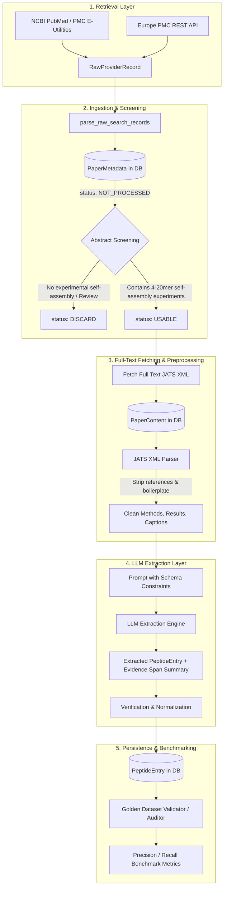

# AI Agent & LLM Onboarding Guide (`AGENTS.md`)

Welcome to the **Peptide Extractor** project! This repository contains the code, data pipelines, benchmarks, and research for an Interdisciplinary Project (IDP) at the **Technical University of Munich (TUM)**.

This document is the authoritative developer and agent onboarding guide. Any AI agent, coding assistant, or developer working in this repository **must** read and follow these guidelines.

> [!NOTE]
> **Living Document Disclaimer**: This guide is continuously updated as research, empirical benchmarks, and system requirements evolve. Architectural decisions (such as LLM model selection, gateway providers, and parsing strategies) are iterative and subject to refinement. Always check recent git commits, issues, and the project tracker (`docs/todos.md`).

---

## 1. Project Mission & Scientific Background

### 1.1 What is this project about?

- **Full Title**: *LLM-Assisted Evidence Extraction for 4–20mer Peptide Self-Assembly Literature*
- **Domain**: Computational Biophysics, Biomaterials, BioNLP, and LLM-assisted Information Extraction.

Short peptides (typically oligopeptides ranging from 4 to 20 amino acid residues) have remarkable capabilities to spontaneously assemble into discrete, ordered nanostructures such as **nanotubes, nanofibers, hydrogels, nanospheres, ribbons, vesicles, organogels, particles, and amyloid-like fibrils**. These nanostructures play vital roles in drug delivery, tissue engineering, nanotechnology, and understanding degenerative amyloid diseases (e.g., Alzheimer's, Parkinson's).

### 1.2 The Core Problem

Experimental records on peptide self-assembly are scattered across tens of thousands of scientific publications spanning several decades. Crucial experimental variables—such as:

- Primary amino acid sequences and terminal caps ($N$-terminal / $C$-terminal modifications)
- Environmental reaction conditions ($\text{pH}$, temperature, peptide concentration)
- Solvent systems, co-solvent ratios, and buffer additives
- Observed nanostructure morphology outcomes
- Analytical detection methods ($\text{TEM}$, $\text{Cryo-EM}$, $\text{AFM}$, $\text{ThT}$, $\text{CD}$, $\text{NMR}$)
- Preparation and dissolution protocols

are embedded within unstructured prose, tables, captions, and supplementary materials. Existing databases (such as SAPDB, PeptideMiner, CPAD 2.0, and Cross-Beta DB) are fragmented, cover different scopes, use disparate schemas, and lack scalable automated literature curation.

### 1.3 The Ultimate Goals

1. **Automated Scientific Literature Retrieval**: Query scientific APIs (NCBI PubMed/PMC, Europe PMC) to retrieve primary literature concerning 4–20mer peptide self-assembly.
2. **Abstract-Level Relevance Screening**: Filter retrieved papers using title and abstract metadata before downloading full texts, avoiding wasteful bandwidth, storage, and LLM token usage.
3. **Structured JATS XML Preprocessing**: Parse structured article XML to isolate high-signal sections (Methods, Results, Discussion, Figure/Table Captions) while discarding boilerplate (references, acknowledgments).
4. **LLM-Based Structured Extraction**: Employ large language models with schema-constrained outputs to extract normalized peptide assembly records grounded in textual evidence spans and location summaries.
5. **Rigorous Golden Benchmark Validation**: Audit extraction precision and recall against an integrated, ground-truth Golden Dataset (1,002+ verified rows synthesized from raw database exports).
6. **Unified Curation Database**: Maintain an auditable relational database (SQLite via SQLModel/Alembic) of all processed papers and extracted peptide entities.

---

## 2. System Architecture & Extraction Pipeline

The end-to-end pipeline consists of five logical stages:



### Pipeline Lifecycle Status (`PaperStatus`)

In `PaperMetadata`, each paper transitions through standardized lifecycle states:

- `NOT_PROCESSED`: Discovered record saved with metadata/abstract; awaiting screening.
- `DISCARD`: Screened out based on title/abstract (e.g., review article, computational-only study, non-peptide system).
- `USABLE`: Passed screening; queued for full-text retrieval.
- `PROCESSED`: Full-text processed and peptide entities extracted.

---

## 3. Repository Structure & Key Components

```
/var/home/can/Documents/idp-docs/project/
├── AGENTS.md                          # <-- YOU ARE HERE: Master AI onboarding & operational manual
├── README.md                          # High-level project summary
├── pyproject.toml                     # uv package configuration, dependencies, pytest settings
├── uv.lock                            # Deterministic dependency lockfile
├── alembic.ini                        # Alembic database migration config
├── alembic/                           # Database migration scripts
│   ├── env.py                         # SQLModel metadata & SQLite batch mode setup
│   └── versions/                      # Migration revision history
├── src/peptide_extractor/             # *** CORE PRODUCTION LIBRARY ***
│   ├── __init__.py
│   ├── schemas.py                     # Pydantic schemas (RawProviderRecord)
│   ├── utils.py                       # Normalizers, deduplication, peptide length dictionary
│   ├── providers.py                   # BaseProvider, NCBIProvider (EuropePMCProvider WIP)
│   ├── pipeline.py                    # Pipeline orchestration scripts (golden dataset & query ingestion)
│   ├── parsers/                       # JATS XML parsing & section extraction (upcoming)
│   └── db/
│       ├── __init__.py                # Database exports & session managers
│       ├── database.py                # SQLModel engine, session contexts, get_engine()
│       ├── paper_metadata.py          # PaperMetadata SQLModel (DOI, PMCID, PMID, status, subset)
│       ├── paper_content.py           # PaperContent SQLModel (paper_id FK, format, raw_content)
│       └── peptide_entry.py           # PeptideEntry SQLModel (WIP: target extraction schema)
├── tests/                             # *** TEST SUITE (pytest) ***
│   ├── conftest.py                    # XML fixtures (PubMed, PMC, minimal) & mock providers
│   └── test_ncbi_provider.py          # 30 passing unit tests for NCBIProvider
├── data/                              # Data directory (Git submodule: idp-data)
│   ├── papers.db                      # Primary SQLite database (tracked via Alembic)
│   └── literature/                    # Benchmark datasets & ground truth files
│       ├── golden_dataset_initial.csv # Standardized 17-column benchmark (1,002 rows)
│       ├── golden_dataset_validator.py# Strict ground-truth validation engine (100% cell match)
│       ├── other/
│       │   ├── consolidated_peptides_master.csv        # 23-column master dataset (5,259 rows)
│       │   └── consolidated_peptides_master_guide.md   # Data dictionary & standards manual
│       ├── sapdb/                     # Raw SAPDB HTML export
│       ├── peptideminer/              # Raw PeptideMiner CSV export
│       ├── cross-beta/                # Raw Cross-Beta DB JSON export
│       └── cpad-2.0/                  # Raw CPAD 2.0 Excel workbooks
├── docs/                              # Developer notes, queries & tutorials
│   ├── plan.md                        # Overall project roadmap & design questions
│   ├── todos.md                       # Task tracker
│   ├── journal.md                     # Research logbook
│   ├── paper-retrieval notes.md       # Search queries across PubMed, WoS, Scopus, EuropePMC
│   ├── golden-dataset notes.md        # Database notes & column mappings
│   └── alembic_tutorial.md            # Step-by-step Alembic migration guide
└── agent-research/ (in parent dir)    # Deep-dive surveys on BioNLP & LLM feature extraction
    ├── 01_scientific_paper_mining_biology/
    └── 02_llm_scientific_paper_feature_extraction/
```

---

## 4. Data Dictionaries & Standards

### 4.1 Missing Value Standards

To ensure consistent feature representation for downstream machine learning and evaluation:

1. **`Not Provided` / `NP`**: The property was **conceptually applicable**, but the authors did not report or measure it (e.g., pH was not measured for an assay).
2. **`Not Applicable (Synthetic)`**: The property **does not exist by design** (e.g., synthetic short peptides like `FF` do not have `start_pos` or `end_pos` within a natural parent protein).
3. **`Not Applicable (Single Solvent)`**: `solvent_ratio` is not applicable because the reaction occurred in a single neat solvent or single aqueous buffer rather than a co-solvent mixture.

### 4.2 Standard 17-Column Schema (`golden_dataset_initial.csv`) & `PeptideEntry`

The properties in `golden_dataset_initial.csv` form the direct fields of extracted `PeptideEntry` objects, complemented by foreign-key lineage and evidence span summaries:

| Column / Property Name                       | Type        | Description                                                                                 | Example Values                                                                                                                 |
| :------------------------------------------- | :---------- | :------------------------------------------------------------------------------------------ | :----------------------------------------------------------------------------------------------------------------------------- |
| `sequence`                                 | String      | Uppercase single-letter amino acid code                                                     | `FF`, `KLVFF`, `VQIVYK`, `AANFLVH`                                                                                     |
| `length`                                   | Integer     | Sequence length in residues                                                                 | `2` to `43` (Target range: 4–20mer)                                                                                       |
| `peptide_name`                             | String      | Common chemical name or parent protein                                                      | `Fmoc-Phe-Phe`, `Alpha-synuclein`                                                                                          |
| `is_aggregated`                            | String      | Binary aggregation label:`'yes'` or `'no'`                                              | `yes`, `no`                                                                                                                |
| `type`                                     | String      | Morphological outcome (10 canonical classes)                                                | `hydrogel`, `fiber`, `tube`, `nanosphere`, `ribbon`, `vesicle`, `particle`, `organogel`, `amyloid`, `none` |
| `n_terminal`                               | String      | N-terminal cap or residue                                                                   | `Fmoc`, `Boc`, `Acetylation`, `Free`                                                                                   |
| `c_terminal`                               | String      | C-terminal cap or residue                                                                   | `Free`, `Amidation`, `Methyl ester`                                                                                      |
| `temperature`                              | String      | Reaction temperature with unit                                                              | `25 °C`, `37 °C`, `Room temperature`, `NP`                                                                           |
| `ph`                                       | String      | Solution pH                                                                                 | `7`, `7.4`, `8.0`, `NP`                                                                                                |
| `peptide_concentration`                    | String      | Normalized concentration in`mg/ml`                                                        | `5.025 mg/ml`, `0.2 mg/ml`, `NP`                                                                                         |
| `solution_system`                          | String      | Primary solvent or buffer                                                                   | `DMSO/PBS`, `H2O`, `Aqueous Buffer`, `NP`                                                                              |
| `solvent_ratio`                            | String      | Mixing ratio ($v/v$) or `'1'` for neat                                                  | `5/95`, `10/90`, `1`, `NP`                                                                                             |
| `solvent_env`                              | String      | Complete solvent description & additives                                                    | `DMSO/PBS (5/95); Dispersion medium= PBS 1x`                                                                                 |
| `detection_method`                         | String      | Characterization techniques used                                                            | `Cryo-EM`, `TEM`, `Confocal Microscopy`, `ThT`                                                                         |
| `preparation_protocol`                     | String      | Step-by-step sample preparation                                                             | `Lyophilized peptide dissolved in DMSO...`, `NP`                                                                           |
| `pmid`                                     | String      | Semicolon-separated PubMed IDs                                                              | `18070345`, `18052148`                                                                                                     |
| `databases`                                | String      | Ground-truth provenance sources                                                             | `SAPDB; PeptideMiner`, `Cross-Beta`, `CPAD-2.0`                                                                          |
| **`paper_id`** *(DB FK)*           | Integer     | Foreign key linking to`paper_metadata.id`                                                 | `1`, `42`                                                                                                                  |
| **`evidence_span`** *(Extraction)* | Text / JSON | Concise summary & quotes indicating where in the paper text/tables the variables were found | `"Methods (p. 3): 'Peptide dissolved in DMSO at 5 mg/ml... Fig 2 shows fiber assembly at pH 7.4'"`                           |

---

## 5. Development Workflow & Commands

### 5.1 Environment & Package Management

Development and execution MUST be performed inside the `idp-dev` Distrobox container where `uv`, Python, and system dependencies are configured.

```bash
# Enter the development container
distrobox enter idp-dev

# Or run commands directly via distrobox
distrobox enter idp-dev -- uv run pytest

# Run tests with coverage
distrobox enter idp-dev -- uv run pytest --cov=peptide_extractor

# Run a script inside the environment
distrobox enter idp-dev -- uv run python src/peptide_extractor/pipeline.py
```

### 5.2 Database Migrations (Alembic + SQLModel)

**Never** modify database tables in `data/papers.db` directly. All schema changes must go through Alembic.
See detailed instructions in [`docs/alembic_tutorial.md`](docs/alembic_tutorial.md).

```bash
# 1. After updating an SQLModel model in src/peptide_extractor/db/
uv run alembic revision --autogenerate -m "describe changes here"

# 2. Inspect the generated migration script in alembic/versions/

# 3. Apply the migration
uv run alembic upgrade head

# 4. Check current revision
uv run alembic current
```

### 5.3 Golden Dataset Validation

To verify the integrity of the benchmark data against raw source databases:

```bash
uv run python data/literature/golden_dataset_validator.py
```

---

## 6. Immediate Roadmap & Current Tasks

Based on the project tracker (`docs/todos.md`), the active milestones are:

1. **Implement `EuropePMCProvider`**:
   - Complete the provider in `src/peptide_extractor/providers.py` implementing `search_by_query`, `search_by_ids`, `parse_raw_search_records`, and `fetch`.
   - Write comprehensive unit tests in `tests/test_europe_pmc_provider.py` mirroring `test_ncbi_provider.py`.
2. **Implement JATS XML Parser (`src/peptide_extractor/parsers/xml_parser.py`)**:
   - Parse structured XML into clean section buckets (`methods`, `results`, `captions`).
   - Strip references (`<ref-list>`), acknowledgments, and boilerplate to conserve LLM token budget.
   - Provide a clean helper to assemble prompt-ready context text.
3. **Formalize `PeptideEntry` SQLModel Schema**:
   - Implement `src/peptide_extractor/db/peptide_entry.py` incorporating the 17 golden dataset properties plus `paper_id` FK and `evidence_span` summary.
   - Generate and apply an Alembic migration.
4. **Implement Abstract Screening Layer**:
   - Introduce a screening step to triage discovered papers (`PaperStatus.NOT_PROCESSED` $\rightarrow$ `USABLE` or `DISCARD`) based on title and abstract heuristics or small models.
5. **Design LLM Extraction Module**:
   - Select model provider/gateway (evaluation of local vs commercial LLM APIs).
   - Constrain outputs using structured schemas (Pydantic / Instructor) to extract `PeptideEntry` and textual evidence summaries.
   - Benchmark end-to-end extraction against the golden dataset papers in `data/papers.db` and measure precision/recall.

---

## 7. Mandatory Rules for AI Agents

When contributing to this repository, AI agents must strictly adhere to the following guardrails:

> [!IMPORTANT]
> 1. **Do Not Break Tests**: Always execute tests inside the container (`distrobox enter idp-dev -- uv run pytest`) before and after modifying code. All tests must pass.
> 2. **Focus Production Code in `src/peptide_extractor/`**: All production parsers, providers, schemas, and models belong directly in `src/peptide_extractor/` accompanied by dedicated unit tests in `tests/`. Do not introduce ad-hoc scratch directories into the repository root.
> 3. **Always Use Alembic for Database Changes**: Any modification to tables or fields in `src/peptide_extractor/db/` requires an Alembic revision (`alembic revision --autogenerate`) and upgrade (`alembic upgrade head`).
> 4. **Respect External API Rate Limits**:
>    - NCBI Entrez: Always supply `api_key`, batch queries (100–150 IDs per request), and respect rate limits (sleep `0.1s - 0.2s` between calls).
>    - Europe PMC: Use cursor pagination with appropriate delays.
> 5. **Preserve Biochemical Conventions**:
>    - Amino acid sequences are strictly uppercase single-letter codes (`A-Z`).
>    - Target oligopeptides are 4–20 amino acids (though synthetic benchmark peptides may include di-/tri-peptides).
>    - Differentiate between `$N$-terminal` / `$C$-terminal` modifications and sequence residue endpoints (`start_pos`, `end_pos`).
> 6. **Ground LLM Extractions in Evidence**: Any extracted peptide entry must include an `evidence_span` summary identifying the section, paragraph, or verbatim text in the paper where the claims were found to ensure full auditability.
