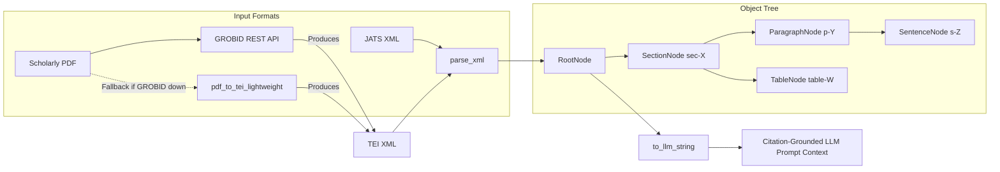

# GROBID Setup & PDF Preprocessing Guide

This document explains how to set up, configure, and use **GROBID** (GeneRation Of BIbliographic Data) for parsing academic PDFs into structured **TEI XML** and object trees within the `peptide_extractor` pipeline.

---

## 1. Overview & Architecture

Scientific full-text publications often exist only in PDF format when JATS XML is unavailable from PubMed Central (PMC). To provide a unified parsing representation for language models and evidence grounding, `peptide_extractor` maps both JATS XML and scholarly PDFs into a shared **Node Object Tree**:



Both JATS XML and GROBID TEI XML generate identical bracketed location tags (e.g. `[sec-0/p-1/s-2]` or `[sec-1/table-0/row-1]`), allowing the downstream LLM extraction prompt and evaluation auditors to work seamlessly across formats.

---

## 2. Setting Up GROBID

GROBID runs as a web service exposing REST APIs. The easiest and recommended way to run GROBID is using Docker.

### Option A: Running via Docker (Recommended)

1. Pull the official GROBID Docker image:
   ```bash
   docker pull grobid/grobid:0.8.1
   ```

2. Start the GROBID container:
   ```bash
   docker run -t --rm --init -p 8070:8070 grobid/grobid:0.8.1
   ```

   > [!TIP]
   > For production or heavy batch jobs, allocate sufficient memory (at least 4 GB RAM) and run detached:
   > ```bash
   > docker run -d --name grobid -p 8070:8070 -m 4g --restart unless-stopped grobid/grobid:0.8.1
   > ```

3. Verify the service is alive:
   ```bash
   curl http://localhost:8070/api/isalive
   # Expected response: true
   ```

---

### Option B: Docker Compose

You can add GROBID to your `docker-compose.yml`:

```yaml
version: '3.8'

services:
  grobid:
    image: grobid/grobid:0.8.1
    container_name: grobid
    ports:
      - "8070:8070"
    restart: unless-stopped
    deploy:
      resources:
        limits:
          memory: 4096M
```

Run with:
```bash
docker compose up -d grobid
```

---

### Option C: Standalone Installation (Without Docker)

If Docker is not available:

1. Requirements:
   - JDK 17+ installed (`java -version`)
2. Download and unpack the release:
   ```bash
   wget https://github.com/kermitt2/grobid/archive/refs/tags/0.8.1.tar.gz
   tar -xzf 0.8.1.tar.gz
   cd grobid-0.8.1
   ```
3. Run with Gradle wrapper:
   ```bash
   ./gradlew run
   ```
   The service will listen on `http://localhost:8070`.

---

## 3. Configuring `peptide_extractor`

GROBID URL configuration can be passed via environment variable or in Python code.

### 1. Environment Variable (`.env`)
Add the following to your `.env` file in the project root:

```env
GROBID_URL=http://localhost:8070
```

If connecting to a remote or cloud-hosted GROBID instance:
```env
GROBID_URL=https://my-grobid-server.example.com
```

---

## 4. Python Usage & API

The module `peptide_extractor.parsers` provides both high-level unified functions and dedicated lower-level converters.

### 4.1 High-Level Unified Interface (Recommended)

Use `parse_document` or `to_extraction_ready_string`. The parser automatically recognizes whether the input is a PDF, JATS XML, or TEI XML string/path:

```python
from peptide_extractor.parsers import parse_document, to_extraction_ready_string

# 1. Directly parse a PDF file into an object tree
root_tree = parse_document("path/to/paper.pdf")

# 2. Convert a PDF directly into an LLM-ready prompt string with citation tags
prompt_text = to_extraction_ready_string("path/to/paper.pdf")
print(prompt_text)
# Output format:
# [sec-0] Introduction
#     [sec-0/p-0]
#         [sec-0/p-0/s-0] Diphenylalanine motifs form nanotubes.
# [sec-1/table-0] Table 1: Assembly characteristics
#     Columns: Sequence | Solvent | Morphology
#     [sec-1/table-0/row-0] FF | Water | nanotube
```

### 4.2 Explicit PDF Parsing

```python
from peptide_extractor.parsers import extraction_ready_string_from_pdf, pdf_to_tei_xml

# Read raw bytes or pass path
with open("paper.pdf", "rb") as f:
    pdf_bytes = f.read()

# Convert PDF to TEI XML string
tei_xml = pdf_to_tei_xml(pdf_bytes, backend="auto")

# Or get the citation-grounded LLM string directly
llm_string = extraction_ready_string_from_pdf(pdf_bytes)
```

### 4.3 Using `GrobidClient` Directly

```python
from peptide_extractor.parsers import GrobidClient

client = GrobidClient(base_url="http://localhost:8070")

if client.is_alive():
    tei_xml = client.process_fulltext_document(
        "paper.pdf",
        consolidate_header=False,
        consolidate_citations=False,
    )
```

---

## 5. Lightweight Fallback (Zero-Daemon Mode)

If GROBID is not running, `peptide_extractor` includes an automatic zero-daemon fallback (`pdf_to_tei_lightweight`):
- When `backend="auto"` (default), the client checks `client.is_alive()`.
- If GROBID is running, it performs full machine learning section/table extraction.
- If GROBID is unreachable, it logs a notification and uses `pdftotext` (from `poppler-utils`) or `pypdf` to extract text, infer section headers, and output well-formed TEI XML.
- This ensures CI test suites, local unit tests, and offline development never break when Docker is stopped.
