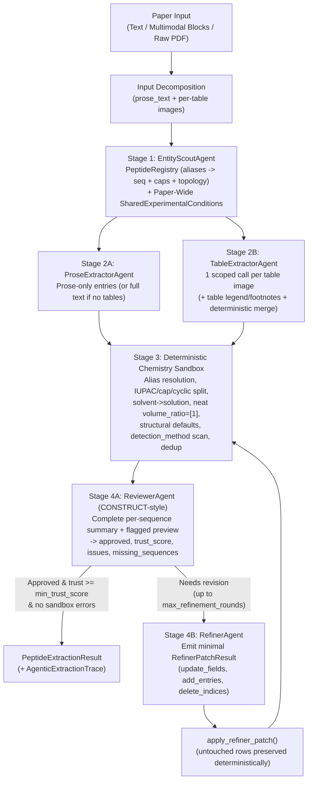

# Multi-Agent Peptide Extraction (`src/peptide_extractor/agentic/`)

This document covers the dedicated multi-agent extraction architecture implemented in `src/peptide_extractor/agentic/`. It replaces open-loop single-pass or two-pass LLM chains with a deterministic **Code-Agency Orchestrator** (`ExtractionOrchestrator`) coordinating five narrow-scope LLM agents and a zero-LLM deterministic chemistry sandbox.

---

## 1. Package Layout

| File | Responsibility |
| :--- | :--- |
| `agentic/__init__.py` | Public exports (`ExtractionOrchestrator`, `run_agentic_extraction`, `AgenticExtractionConfig`, `AgenticExtractionTrace`, agents, schemas, and sandbox utilities). |
| `agentic/schemas.py` | Typed Pydantic contracts for inter-agent handoffs (`PeptideAlias`, `EntityRegistryResult`, `ValidationIssue`, `DeterministicValidationReport`, `ReviewIssue`, `ReviewerFeedback`, `FieldUpdate`, `RefinerPatchResult`, `AgenticExtractionConfig`, `AgenticExtractionTrace`). |
| `agentic/agents.py` | Five specialized agent classes wrapping `LLMController`: `EntityScoutAgent`, `ProseExtractorAgent`, `TableExtractorAgent`, `ReviewerAgent`, and `RefinerAgent`. |
| `agentic/chemistry_sandbox.py` | Zero-LLM deterministic normalization, biochemical validation, MW unit conversion, paper-wide detection-method scanning, and cross-pass deduplication. |
| `agentic/orchestrator.py` | `ExtractionOrchestrator`, `apply_refiner_patch()`, `_extract_table_context()`, and convenience entrypoint `run_agentic_extraction()`. |

---

## 2. Orchestration Flow



---

## 3. Agent Roles & Contracts (`agents.py` & `schemas.py`)

Each agent runs a narrow, single-hop prompt with strict Pydantic structured output via `LLMController`, enabling heterogeneous model assignment (e.g., local Ollama SLMs, `gemma-4-31b-it`, `gemini-3.5-flash-lite`, or OpenRouter models per role).

### 3.1 `EntityScoutAgent` (Stage 1)
- **Purpose**: Resolves paper-specific compound identifiers before condition extraction so tables never emit raw labels (`"1a"`, `"P3"`) or drop terminal caps.
- **Output (`EntityRegistryResult`)**:
  - `peptides: list[PeptideAlias]` — maps `label` → canonical 1-letter `sequence`, `n_terminal`, `c_terminal`, `linear_cyclic` (`linear` | `cyclic`), `chirality`, `peptide_conjugate_mixture` (`peptide` | `conjugate` | `mixture`), `conjugate_partner`, and `evidence_tag`.
  - `shared_conditions: SharedExperimentalConditions` — paper-wide defaults (`temperature`, `incubation_period`, `ph`, `peptide_concentration`, `solution`, `solvent`, `volume_ratio`, `linear_cyclic`, `peptide_conjugate_mixture`, `detection_method`, `preparation_protocol`, `evidence_span`).

### 3.2 `ProseExtractorAgent` (Stage 2A)
- **Purpose**: Extracts experimental `(peptide, condition)` records reported in narrative prose, conditioned on the `PeptideRegistry` and `shared_conditions`.
- **Scope**: When table images are present (`tables_extracted_separately=True`), extracts only prose-reported entries not already covered by tables; otherwise extracts all entries from text and inline tables.
- **Output**: `PeptideExtractionResult`.

### 3.3 `TableExtractorAgent` (Stage 2B)
- **Purpose**: Extracts every row and tested cell from a single cropped table image into a compact row-grouped schema (`TableExtractionResult`) to avoid output truncation and repetitive JSON loops.
- **Context Provided**:
  - Compact `PeptideRegistry` summary (for alias/cap resolution)
  - Paper-wide `shared_conditions` summary
  - Table caption + surrounding legend/footnotes extracted by `_extract_table_context()` from the prose around `[table_id]`
  - Explicit screening-table symbol guidance (`G`/`TG`/`OG`/`CG`/`PG`/`WG`/`HG` → `organogel`/`hydrogel`; only `S`/`Sol`/`I`/`P`/`NG`/`-` → `none`)
- **Merge**: `merge_table_result_with_shared()` unrolls each `(row, cell)` with precedence `cell → row → table_defaults → shared_conditions` and propagates `[table_id]` or Pass-1 `evidence_span` tags.

### 3.4 `ReviewerAgent` (Stage 4A)
- **Purpose**: Evidence-independent CONSTRUCT-style auditor that critiques candidate entries against the source text, `PeptideRegistry`, and `DeterministicValidationReport`.
- **Full-Table Visibility**: Receives a **complete per-sequence coverage summary** across *all* extracted entries (sequence, total/assembling/none counts, N-/C-caps, solution coverage) plus an indexed JSON preview prioritizing flagged entries—preventing blind spots on 200+ row screening tables.
- **Output (`ReviewerFeedback`)**: `approved`, `trust_score` (`[0.0, 1.0]`), `issues: list[ReviewIssue]`, `missing_sequences: list[str]`, and `revision_instructions`.
- **Early Exit**: If `approved=True`, `trust_score >= min_trust_score`, `missing_sequences` is empty, and the sandbox reports no unresolved errors, the orchestrator exits immediately without invoking `RefinerAgent`.

### 3.5 `RefinerAgent` (Stage 4B)
- **Purpose**: Applies targeted fixes based on `ReviewerFeedback` and unresolved sandbox errors.
- **Patch-Based Safety (`RefinerPatchResult`)**: Instead of regenerating the full `PeptideExtractionResult` array (which would truncate or drop rows on large screening tables), `RefinerAgent` emits minimal patches:
  - `update_fields: list[FieldUpdate]` (`entry_index`, `field`, `value`)
  - `add_entries: list[PeptideLLMEntry]`
  - `delete_indices: list[int]`
- Applied deterministically by `apply_refiner_patch()`, then re-validated by the Chemistry Sandbox.

---

## 4. Deterministic Chemistry Sandbox (`chemistry_sandbox.py`)

Runs after Stage 2 (and after every Stage 4 patch) at **zero LLM token cost**:

1. **Alias Resolution**: Resolves labels like `"1a"` or `"P2"` left in `sequence` via `PeptideRegistry` and backfills missing `n_terminal`, `c_terminal`, `linear_cyclic`, `chirality`, `peptide_conjugate_mixture`, and `conjugate_partner`.
2. **Sequence & Cap Splitting (`split_sequence_and_caps`)**:
   - Unwraps `cyclo(...)` / `c[...]` → sets `linear_cyclic = "cyclic"`.
   - Strips leaked N-terminal prefixes (`Fmoc-`, `Boc-`, `Cbz-`, `Ac-`, `Nap-`, `H2N-`) and C-terminal suffixes (`-NH2`, `-CONH2`, `-OH`, `-COOH`, `-OMe`, `-OEt`, `-OBn`, `-OCH2Ph`).
   - Converts 3-letter (`Ser-Val-Gly`) or hyphenated 1-letter (`K-L-V-F-F`) sequences into uppercase 1-letter IUPAC codes.
3. **Solvent & Ratio Normalization**:
   - Mirrors `solvent` into `solution` whenever `solution` is null/empty.
   - Defaults `volume_ratio = [1]` for neat single-component solvents.
4. **Structural Field Defaults**:
   - Sets `linear_cyclic = "linear"` if still null after registry inheritance, and `peptide_conjugate_mixture = "conjugate"` (if `conjugate_partner` is set) or `"peptide"`.
5. **Paper-Wide Detection Method Supplementation (`extract_paper_detection_methods`)**:
   - Regex-scans the paper text for canonical techniques (`Vial Inversion`, `TEM`, `Cryo-EM`, `SEM`, `AFM`, `CD`, `FTIR`, `NMR`, `XRD`, `DLS`, `UV-Vis`, `Fluorescence`, `Rheology`, `Optical Microscopy`, `Confocal Microscopy`, `ThT`, `Congo Red`, `Raman`, `Turbidity`) and unions missing techniques into entries.
6. **Physical & IUPAC Validation**:
   - Flags non-IUPAC characters, `ph` outside `[0, 14]`, `temperature` outside `[-80, 250] °C`, `peptide_concentration <= 0`, `incubation_period < 0`, and `conjugate_partner` conflicts.
7. **Cross-Pass Deduplication**:
   - Merges duplicate `(sequence, n_terminal, c_terminal, type, solution, solvent, volume_ratio, temperature, ph, concentration)` rows from prose and tables, keeping the richer entry and unioning `evidence_span` tags.
8. **Molecular Weight & Molar Unit Helpers**:
   - Exposes `estimate_peptide_mw()` and `convert_concentration_to_mg_ml()` for deterministic `M`/`mM`/`µM`/`nM`/`wt%` → `mg/ml` conversion.

---

## 5. Configuration & Usage

### 5.1 `AgenticExtractionConfig` Options

| Parameter | Default | Description |
| :--- | :--- | :--- |
| `provider` / `model_name` | `"google_genai"` / `"gemma-4-31b-it"` | Default LLM provider and model for all roles. |
| `base_url` | `None` | Optional Ollama endpoint (e.g., `"http://localhost:11435"`). |
| `scout_provider` / `scout_model_name` | `None` | Optional override for `EntityScoutAgent`. |
| `table_provider` / `table_model_name` | `None` | Optional override for `TableExtractorAgent` (e.g., VLM). |
| `reviewer_provider` / `reviewer_model_name` / `reviewer_base_url` | `None` | Optional cross-family override for `ReviewerAgent`. |
| `refiner_provider` / `refiner_model_name` | `None` | Optional override for `RefinerAgent`. |
| `enable_entity_scout` | `True` | Toggle Stage 1 Entity & Alias Scout. |
| `enable_chemistry_sandbox` | `True` | Toggle Stage 3 Deterministic Chemistry Sandbox. |
| `enable_reviewer` | `True` | Toggle Stage 4 Review → Refine loop. |
| `max_refinement_rounds` | `1` | Maximum patch rounds (`0`–`3`). |
| `min_trust_score` | `0.8` | Minimum Reviewer `trust_score` required to skip refinement. |

### 5.2 Pipeline Wrapper (`pipeline.py`)

```python
from peptide_extractor.pipeline import run_peptide_extraction
from peptide_extractor.golden_benchmark import DEV_BENCHMARK_PMIDS

failed_ids, run_id = run_peptide_extraction(
    provider="google_genai",
    model_name="gemma-4-31b-it",
    tables_as_images=True,
    agentic=True,
    reviewer_provider="ollama",
    reviewer_model_name="deepseek-r1:8b",
    max_refinement_rounds=1,
    pmid=list(DEV_BENCHMARK_PMIDS),
)
```

### 5.3 Auditable Trace Mode (`orchestrator.py`)

```python
from peptide_extractor.agentic import AgenticExtractionConfig, ExtractionOrchestrator

cfg = AgenticExtractionConfig(
    provider="google_genai",
    model_name="gemini-3.5-flash-lite",
    max_refinement_rounds=1,
)
trace = ExtractionOrchestrator(cfg).run_with_trace(extraction_payload, filename="paper_9.pdf")
print(trace.initial_entry_count, "->", trace.final_entry_count)
print(trace.review_history)
```

### 5.4 CLI YAML Configuration (`cli.py`)

```yaml
steps:
  - extraction

extraction:
  provider: "google_genai"
  model_name: "gemma-4-31b-it"
  tables_as_images: true
  agentic: true
  reviewer_provider: "ollama"
  reviewer_model_name: "deepseek-r1:8b"
  max_refinement_rounds: 1
  delay_seconds: 4
```
