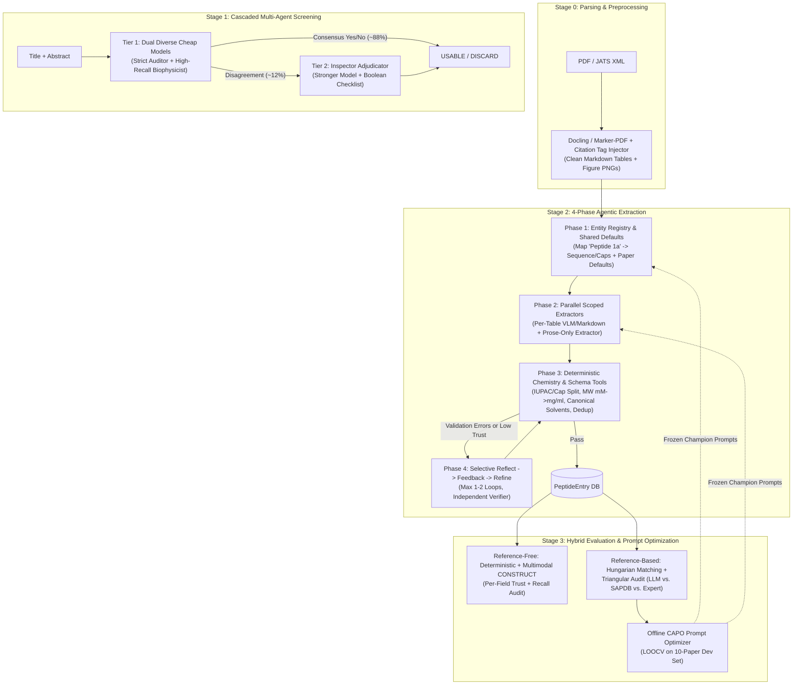

# Agentic & SOTA Methods for Scientific Information Extraction, Screening, and Evaluation
**A Research Report & Architectural Roadmap for `peptide_extractor`**

---

## 1. Diagnosis of Current Pipeline Bottlenecks

Before surveying the literature, an audit of the current codebase ([relevance.py](../../src/peptide_extractor/relevance.py), [extraction.py](../../src/peptide_extractor/extraction.py), [evaluation.py](../../src/peptide_extractor/evaluation.py), [golden_benchmark.py](../../src/peptide_extractor/golden_benchmark.py), [parsers.py](../../src/peptide_extractor/parsers.py)) and the latest 71-paper benchmark results in [9. seminar (24.11.2026).md](../seminar_notes/9.%20seminar%20(24.11.2026).md) reveals four concrete structural bottlenecks:

| Pipeline Stage | Current Approach | Observed Failure Modes & Metrics |
| :--- | :--- | :--- |
| **Document & Table Parsing** | GROBID TEI XML + `TableNode` or full-width PyMuPDF table cropping | Text-only parsing severely drops screening tables (**Assembling R = 5.5%–23.7%**). Cropped table images improve recall, but `TableNode` XML text is often broken, and figures/plots are underutilized. |
| **Relevance Screening** | Single-shot bulk LLM call (10 papers/prompt, `temp=0`) | Uncalibrated self-reported `confidence`; cross-paper attention bleed and omitted IDs in bulk batches; no cross-model/persona verification for borderline abstracts. |
| **Peptide Extraction** | Open-loop 1-pass or 2-pass factored chain (`Pass 1` prose/defaults → `Pass 2` per-table image → deterministic merge) | **71-paper Factored Multimodal**: Seq R = 83.4%, **Seq P = 45.0%** (313 vs. 169 manual); Assembling R = **37.5%**, Condition P = **47.4%**. Severe field drops on `c_terminal` (**15.0%** Norm), `detection_method` (**29.7%**), `solution` coverage (182/441). No verification loop, no compound-ID resolution (e.g., `"Peptide 1a"`), no deterministic MW/unit conversion (`mM → mg/ml`), no prose/table deduplication. |
| **Evaluation** | Reference-free: single `deepseek-r1:8b` judge on `(field, value, quote_text)`. Reference-based: greedy bipartite matching against SAPDB/PeptideMiner. | Reference-free judge fails on image-cited `[table-0]` tags (empty/broken XML text), misses **omitted rows (recall)**, and does not feed back into extraction. Reference-based benchmark assumes curated DBs are 100% complete (conflating *newly recovered valid entries* with *false positives*). |

---

## 2. State-of-the-Art Literature Synthesis (2025–2026)

Recent empirical studies in chemistry, materials science, and biomedical systematic reviews converge on a clear finding: **naïve "throw more agents at it" architectures often underperform or waste tokens, whereas targeted, schema-guided, tool-augmented, and evidence-independent agentic workflows deliver dramatic F1 gains.**

### 2.1 Key Papers & Empirical Findings

| System / Paper | Domain | Core Agentic Mechanism | Headline Empirical Result |
| :--- | :--- | :--- | :--- |
| **AutoTPD / CAPO** *(Rao et al., [arXiv:2605.11221](https://arxiv.org/html/2605.11221v2), Nov 2026)* | Medicinal Chemistry (PROTACs & Molecular Glues vs. curated DBs) | **Cross-validated Agentic Prompt Optimization (CAPO)**: Extractor + Analyst + Refiner in LOOCV on just 7 annotated papers; 4-phase stateful extraction (main text → sentence verification → SI → identifier completion); triangular evaluation. | Record-level **F1: 0.626 → 0.980** (outperforming GEPA's 0.907); transferred to PROTACs at **F1 ≥ 0.93**; recovered **81%–92% more valid records** than manually curated DBs (82.5%–92% expert-verified). |
| **SciKGExtract** *(Sadruddin & D'Souza, [arXiv:2610.06322](https://arxiv.org/html/2610.06322v1), Oct 2026)* | Materials Science (176 ALD papers, 65-property schema) | **Extract & Normalize → Reflect → Feedback → Refine** loop; PubChem chemical canonicalization *inside* the pipeline; controlled comparison of Direct vs. Self-Refine vs. 2-Judge vs. 3-Judge vs. Debate. | PubChem normalization improved F1 for **every** model. Agentic refinement raised ZnO F1 **0.591 → 0.805**. **Crucial caveat**: on complex multi-component IGZO, 2-judge beat 3-judge and debate (*"more agents are not always better"*). Cheap extractor (Llama 3.3 70B) + reflection beat GPT-4o at ~12× lower cost. |
| **MDA (Material Database Agent)** *(Chandrasekhar et al., [arXiv:2605.04278](https://arxiv.org/html/2605.04278v1), May 2026)* | Materials Science (MeltpoolNet, HEA/CCA) | **MCP-wrapped `marker-pdf`** decomposes PDFs into structured Markdown + figure JPEGs → parallel `doc-writer` sub-agents per paper → `csv-writer` aggregator. | Near-human plot digitization (MAE 1.09–1.61 K with frontier VLMs) and 86%–100% row recovery; demonstrates that **multimodal locality + clean Markdown table parsing** is foundational. |
| **ChemX Benchmark** *(Vepreva et al., [arXiv:2510.00795](https://arxiv.org/html/2510.00795v1), Oct 2025)* | Chemistry (10 curated datasets: nanomaterials & small molecules) | Benchmarks GPT-5, GPT-5 Thinking, ChatGPT Agent, SLM-Matrix, FutureHouse, Eunomia, and a clean single-agent `marker-pdf` + VLM-captioning pipeline. | Structured preprocessing raised GPT-5 recall **0.53 → 0.75**. Heavy generic multi-agent frameworks (**SLM-Matrix**, **FutureHouse**) **underperformed** clean modular pipelines; extended "Thinking" mode degraded structured extraction when misconfigured. |
| **Two-MAS SLR** *(Ren et al., [arXiv:2607.21920](https://arxiv.org/html/2607.21920v1), Jul 2026)* & **Multi-LLM Screening** *([medRxiv 25333429v4](https://www.medrxiv.org/content/10.1101/2025.08.11.25333429v4), Jan 2026)* | Systematic Literature Reviews (2,245 trials) | **Screening MAS**: Heterogeneous personas (Strict Regulator, Permissive Clinician, Logic/Boolean, Domain Specialist) + Inspector follow-up questions + HITL on non-consensus. **Extraction MAS**: Standardization → Iterative correction (3 rounds) → Confidence labels via cross-round consistency. | Screening sensitivity jumped **58.3% → 92.6%** (PPV 98.7%) on conservative models; majority voting across diverse cheap LLMs achieved **95% recall with up to 68% workload reduction**. Extraction reached **97.2%** accuracy after flagging only ~7.8% low/medium-confidence cells. |
| **CONSTRUCT** *(Goh & Mueller, [arXiv:2603.18014](https://arxiv.org/html/2603.18014v2), Mar 2026)* | Reference-Free Structured Output Verification | Two-step black-box verifier: first **flag erroneous/uncertain fields** (binary structured reasoning), then elicit document-level trustworthiness score. | Outperforms both single-call and multi-call LLM-as-a-Judge and token logprobs on AUROC/precision/recall for catching extraction errors, at lower token cost. |
| **LitXBench** *(Chong & Colindres, [arXiv:2604.07649](https://arxiv.org/html/2604.07649v1), ICML '26)* | Materials Experiment Extraction (1,426 datapoints) | Experiment-centric schema with **code-based validation** and weighted multi-aspect F1 (Measurements, Process Conditions, Materials, Configurations). | Exposes that flat composition-grouped tables lose processing-history linkage; executable schema validation catches structural/unit errors deterministically. |

> [!IMPORTANT]
> **The Unifying Principle — Evidence Independence ([ResearchGate Aug 2026](https://www.researchgate.net/publication/412184935_Comparing_Self-Verification_Multi-Agent_Verification_and_External_Retrieval)):**
> Self-verification by the *same* model seeing the *same* prompt suffers from shared blind spots and manufactured consensus. Verification yields real precision/recall gains only when the verifier has **conditionally independent evidence**: deterministic domain/chemistry tools, a different model family/persona, or direct re-inspection of the raw table image/source snippet.

---

## 3. Concrete Architectural Recommendations for `peptide_extractor`

Below is a redesigned, end-to-end agentic architecture tailored specifically to `peptide_extractor`'s SQLModel/LangChain stack, 17-column biochemical schema, and cost constraints.

---

### Stage 0: Document Parsing & Table Representation ([parsers.py](../../src/peptide_extractor/parsers.py))

1. **Benchmark `Docling` or `Marker-PDF` as a PDF Backend Alongside GROBID**:
   - Both **SciKGExtract** (`Docling`) and **MDA / ChemX** (`marker-pdf`) abandoned older XML parsers for PDFs because layout-aware Markdown/HTML table extraction preserves merged headers, multi-row cells, and chemical subscripts far better than GROBID TEI `<figure type="table">`.
   - You can keep your exact bracketed location-tag system (`[sec-1/p-2/s-1]`, `[sec-1/table-0]`) by converting Docling's structured JSON/document tree into your existing `RootNode` tree—preserving 100% compatibility with `evidence_span` grounding while fixing broken `TableNode` text.
   - **Dual-representation tables**: For complex screening matrices, pass **both** the clean Markdown table *and* the cropped table PNG to Pass 2 so the VLM never hallucinates OCR characters (e.g., `I` vs `L`, `0` vs `O`) while retaining visual row/column alignment.

---

### Stage 1: Relevance Screening ([relevance.py](../../src/peptide_extractor/relevance.py))

1. **Replace Single-Shot Bulk Screening with a 2-Tier Cascaded Ensemble**:
   - **Why**: Both systematic-review MAS papers ([arXiv:2607.21920](https://arxiv.org/html/2607.21920v1) and [medRxiv 25333429v4](https://www.medrxiv.org/content/10.1101/2025.08.11.25333429v4)) prove that **model diversity + heterogeneous personas** beats any single LLM while keeping cost low.
   - **Tier 1 (Cheap Parallel Consensus)**: Run **two diverse, low-cost models** (e.g., `gemini-flash-lite` + local `gemma` or `qwen`) with **two complementary personas**:
     - *Persona A (High-Recall Biophysicist)*: Looks for any experimental hint of short-peptide assembly/gelation/fibrillation.
     - *Persona B (Strict Scope Regulator)*: Checks explicit exclusion rules (review article? purely MD/computational? intact full-length protein >30aa without isolated fragments?).
   - **Routing**:
     - Both `True` → `PaperStatus.USABLE` (auto-accept).
     - Both `False` → `PaperStatus.DISCARD` (auto-discard).
     - **Disagreement (~10–15% of papers)** → Escalate to **Tier 2 Inspector Agent** (a stronger model) that receives both rationales plus a structured Boolean criteria checklist (`has_short_peptide`, `is_wet_lab`, `reports_assembly_or_non_assembly`, `is_not_review`) to make the final call (or flag for human review).
2. **Eliminate Bulk-10 Attention Bleed**:
   - Move from 10 abstracts in one prompt (which currently drops paper IDs and triggers `missing_ids` failures) to **async parallel single-abstract calls** (or micro-batches of 3) with structured JSON output. For cheap flash/local models, concurrency gives the same wall-clock speed with much higher precision and zero cross-paper bleed.

---

### Stage 2: Peptide Information Extraction ([extraction.py](../../src/peptide_extractor/extraction.py))

Your current **Two-Pass Factored Extraction** (`Pass 1` shared conditions + `Pass 2` per-table image) is already a strong foundation—it just lacks **entity resolution**, **deterministic biochemical tools**, **closed-loop verification**, and **automated prompt optimization**.

#### 2.1 Add a "Document Entity Registry" to Pass 1 (Fixes 45% Sequence Precision & Missed Cyclics)
- **Problem**: Papers routinely refer to peptides as `"1"`, `"2a"`, `"P3"`, `"Fmoc-FF"`, or `"cyclo(KL)"` in tables while defining their full sequences and N-/C-terminal caps in Scheme 1, Methods, or Table 1. Without a registry, Pass 2 invents invalid sequences or loses terminal caps (`c_terminal` Norm = 15.0%).
- **Solution**: Expand `PaperWideExtractionResult` to include a `peptide_registry: list[PeptideAlias]` mapping every paper alias/label → `{canonical_sequence, n_terminal, c_terminal, linear_cyclic, chirality, peptide_conjugate_mixture, conjugate_partner, evidence_tag}`. Pass this compact registry into every Pass 2 table call.

#### 2.2 Insert a Deterministic Biochemical Validation & Tool Layer (Phase 3 — Zero LLM Cost)
Inspired by **SciKGExtract**'s in-pipeline chemical normalization and **LitXBench**'s code-based validation, run deterministic Python validators/tools *immediately after extraction and before saving or reflecting*:
1. **IUPAC Sequence & Cap Splitter**:
   - Validate `sequence` against the 20 canonical (plus allowed non-canonical) amino acids.
   - Deterministically detect and strip leaked caps (`Ac-`, `Fmoc-`, `Boc-`, `-NH2`, `-OH`, `-OMe`, `cyclo(...)`) into `n_terminal`, `c_terminal`, and `linear_cyclic`—directly fixing the `c_terminal` (15% Norm) and missed-cyclic errors.
2. **Molecular Weight Concentration Converter Tool**:
   - LLMs frequently miscalculate `mM`/`µM` → `mg/ml` (`peptide_concentration` Norm = 57%–77%).
   - Have the LLM extract `(raw_concentration_value, raw_concentration_unit)` (e.g., `10.0`, `"mM"` or `1.0`, `"wt%"`) and let a deterministic Python function compute exact `mg/ml` from the peptide's sequence + terminal cap molecular weights.
3. **In-Pipeline Canonicalization**:
   - Move the solvent, terminal-cap, volume-ratio, and detection-method canonicalizers currently sitting in [golden_benchmark.py](../../src/peptide_extractor/golden_benchmark.py) **into the extraction post-processor** (preserving raw strings for provenance, just like SciKGExtract).
4. **Cross-Pass Deduplicator**:
   - Merge duplicates emitted by both Pass 1 (`prose_entries`) and Pass 2 (`table_entries`) by grouping on `(sequence, n_terminal, c_terminal, normalized_solvent, ph, temperature, concentration)` and keeping the richer/better-grounded record.

#### 2.3 Add Selective `Reflect → Feedback → Refine` (Phase 4 — Max 1–2 Loops)
- Following **SciKGExtract**'s finding (*"agentic refinement helps, but more agents are not always better"*):
  - **Do NOT** run a 4-agent debate on every paper.
  - Run a **targeted 1-pass Reflector/Critic** (using a *different* model family or fresh context) **only when**:
    1. Phase 3 deterministic checks raise validation errors (e.g., invalid sequence, `pH > 14`, missing `solution`/`volume_ratio` on table rows, `detection_method` empty despite Methods section), **OR**
    2. A lightweight **Recall/Completeness Check** spots unextracted sequences or table rows (comparing the count of rows in the table image/Markdown against `len(table_result.rows)`).
  - The Critic returns **actionable, targeted patch instructions** (e.g., *"Row 4 in Table 2 (sequence KLVFF) is missing; c_terminal for all peptides is stated as `-NH2` (amidation) in [sec-1/p-2/s-1]"*), and the Extractor executes a single targeted revision.

#### 2.4 Replace Manual Prompt Iteration (`V3 → V5 → V6`) with Offline CAPO / DSPy Optimization
- **AutoTPD** ([arXiv:2605.11221](https://arxiv.org/html/2605.11221v2)) is the single highest-leverage technique for this setup: `DEV_BENCHMARK_PMIDS` (10 papers) and `benchmark_run_against_golden()` already exist.
- Implement **CAPO (Cross-validated Agentic Prompt Optimization)** offline on those 10 papers (e.g., 5-fold or 10-fold LOOCV):
  1. Run current prompt on training fold → compute errors via `golden_benchmark.py`.
  2. **Analyst Agent** diagnoses recurring failure modes across below-threshold papers (e.g., *"Pass 2 drops `solution` when solvent is in column headers rather than cell text"*, *"Pass 1 misses `detection_method` listed in figure captions"*).
  3. **Refiner Agent** proposes at most 2 generalizable rule edits to the prompt (schema stays frozen; no paper-specific hardcoding).
  4. Select the **Champion Prompt** with highest held-out F1, freeze it, and evaluate on the remaining 61 golden papers.
- This systematically solves prompt brittleness without overfitting, and once frozen, adds **zero runtime inference cost**.

---

### Stage 3: Evaluation & Benchmarking ([evaluation.py](../../src/peptide_extractor/evaluation.py) & [golden_benchmark.py](../../src/peptide_extractor/golden_benchmark.py))

#### 3.1 Upgrade Reference-Free Evaluation (`evaluation.py`)
1. **Fix Multimodal Table Grounding**:
   - Currently, `get_node_by_id(with_sentences, "[sec-1/table-0]")` passes `quote.content` (which is empty or garbled for image-based `TableNode`s) to `deepseek-r1:8b`.
   - Fix: When the cited `Node` is a `TableNode` or `ImageNode` with `image_bytes`, pass the **table image (or Docling Markdown)** to a VLM verifier.
2. **Adopt CONSTRUCT-Style Two-Step Trustworthiness Scoring ([arXiv:2603.18014](https://arxiv.org/html/2603.18014v2))**:
   - Instead of asking a small local model for a bare `{field: bool}` dictionary, prompt a stronger verifier (or cross-model judge) to:
     1. **Step 1**: Explicitly list which fields appear *incorrect, ungrounded, or scientifically inconsistent* (with a 1-sentence reason per flagged field).
     2. **Step 2**: Output an overall entry-level trustworthiness score $S_{\text{entry}} \in [0, 1]$.
   - Combine with **Layer 1 Deterministic Checks** (valid IUPAC, physical ranges for `temperature`/`ph`/`concentration`, valid `evidence_span` tag existence) to produce a composite **3-Tier Quality Gate** (`High Trust` → auto-accept; `Medium` → trigger Phase 4 Refine; `Low` → flag for human review).
3. **Add a Reference-Free Recall/Omission Auditor**:
   - Current `evaluation.py` measures only *groundness* (precision) and *completeness* (non-null fields), so an extractor that returns 1 perfect row out of 50 gets a 100% groundness score.
   - Add a lightweight paper-level audit step: pass the list of extracted `(sequence, n_terminal, c_terminal, count_of_conditions)` alongside the paper's Methods/Results/Table captions and ask an independent LLM: *"List any experimental peptide sequences or tested condition groups mentioned in this paper that are MISSING from the extracted summary."*

#### 3.2 Upgrade Reference-Based Benchmarking (`golden_benchmark.py`)
1. **Optimal Bipartite Matching**:
   - Replace the greedy matcher in `_match_entries_for_sequence()` ([golden_benchmark.py](../../src/peptide_extractor/golden_benchmark.py#L310-L334)) with exact maximum-weight matching via `scipy.optimize.linear_sum_assignment` (Hungarian algorithm) to prevent suboptimal pairings on large screening matrices (e.g., PMID `20460796` with 240 rows).
2. **Triangular Evaluation (Critical for the 45% Sequence Precision)**:
   - In **AutoTPD**, manually curated databases (MolGlueDB / PROTAC-DB) missed **38%–68%** of valid ground-truth records in the papers.
   - The 71-paper run extracted 313 unique sequences vs. 169 in SAPDB/PeptideMiner (`P = 45.0%`). Before aggressively tightening prompts to suppress sequences, **audit a stratified sample of ~30–50 "LLM-only" sequences/rows** against the source PDFs to measure what fraction are *true hallucinations* vs. *valid peptides that SAPDB/PeptideMiner simply never curated* (e.g., negative controls, non-assembling analogues, or newly tested conditions).

---

## 4. What to Avoid (Anti-Patterns Proven in 2025–2026 Benchmarks)

- **Deep multi-agent debate (>2 judges) for every paper**: SciKGExtract showed 3-judge and debate workflows cost 3×–5× more tokens and *degraded* F1 on complex multi-component experiments compared to 2-judge or targeted 1-pass reflection.
- **Heavy MCTS / trajectory-search frameworks (e.g., SLM-Matrix)**: ChemX showed they are brittle, slow, and underperformed clean, well-preprocessed modular workflows on real chemical PDFs.
- **Same-model self-verification without external tools**: Without deterministic chemistry validators or a different model/fresh context, LLMs rubber-stamp their own hallucinations.
- **Blindly enabling extended "Thinking" mode on structured extraction**: ChemX observed severe F1 drops for `GPT-5 Thinking` vs. standard `GPT-5` on structured JSON extraction due to over-thinking and schema drift.

---

## 5. Prioritized Implementation Roadmap (By ROI)

| Priority | Initiative | Target Files | Expected Impact | Token / Compute Cost |
| :---: | :--- | :--- | :--- | :--- |
| **P0 (Quick Win)** | **Deterministic Chemistry & Schema Tools** (IUPAC/cap splitter, MW `mM→mg/ml` converter, in-pipeline solvent/detection canonicalizer, cross-pass deduplicator) + **Hungarian matching** | [extraction.py](../../src/peptide_extractor/extraction.py), [golden_benchmark.py](../../src/peptide_extractor/golden_benchmark.py) | Immediate jump in `c_terminal`, `peptide_concentration`, `solution`, `detection_method` accuracy and precision. | **Zero** extra LLM tokens |
| **P1 (High ROI)** | **Entity Registry in Pass 1 + Dual Table Input (Docling/Marker Markdown + Image)** + **Triangular Audit of "False Positives"** | [parsers.py](../../src/peptide_extractor/parsers.py), [extraction.py](../../src/peptide_extractor/extraction.py) | Fixes missed cyclics, table row drops, and alias confusion (`"Peptide 1a"`), raising Assembling Recall & Condition Precision. | Low (+10–15% tokens) |
| **P2 (High ROI)** | **Offline CAPO Prompt Optimization** (LOOCV on the 10-paper `DEV_BENCHMARK_PMIDS`) | New `prompt_optimizer.py` + [extraction.py](../../src/peptide_extractor/extraction.py) | Systematic, data-driven F1 boost across all fields (AutoTPD saw +35 F1 pts). | One-time offline cost; **zero** runtime overhead |
| **P3 (Medium-High)** | **Selective `Reflect → Feedback → Refine` Loop (1 pass)** + **Multimodal CONSTRUCT Evaluation & Recall Auditor** | [extraction.py](../../src/peptide_extractor/extraction.py), [evaluation.py](../../src/peptide_extractor/evaluation.py) | Closes the open-loop pipeline; catches missing rows and table hallucinations; produces calibrated trust scores. | +30–60% tokens *only on flagged papers* |
| **P4 (Medium)** | **2-Tier Cascaded Multi-Agent Screening** (Dual cheap personas → Inspector on ~12% disagreements, async single-paper calls) | [relevance.py](../../src/peptide_extractor/relevance.py) | Higher recall & precision at scale with automatic HITL triage for borderline abstracts. | Low (~1.3× cheap tokens) |
