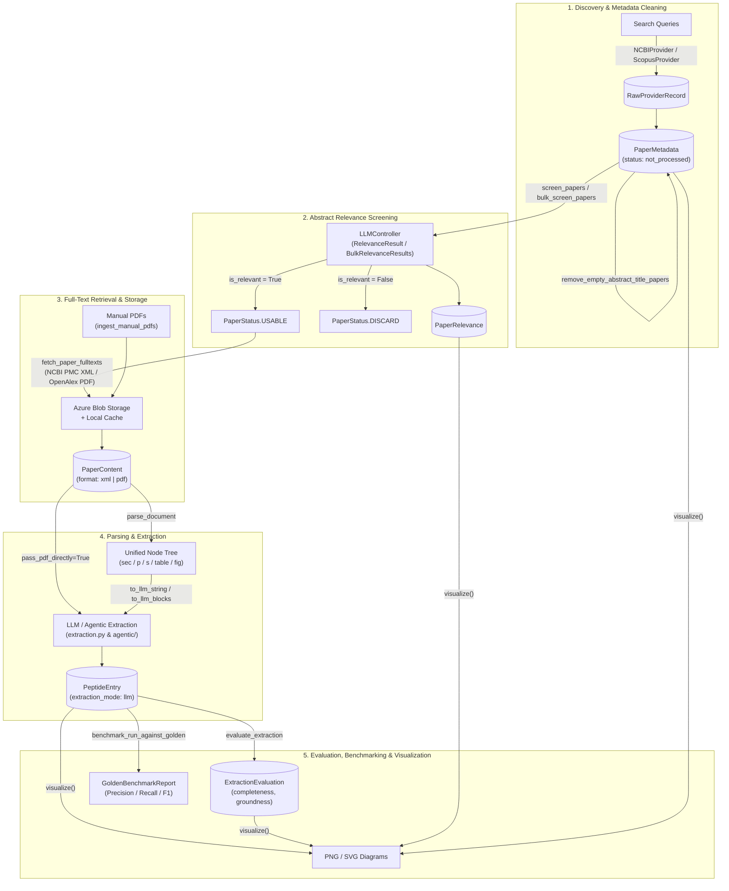

# System Design & Pipeline Architecture

`peptide_extractor` is an end-to-end literature curation pipeline for extracting structured experimental records on **4–20mer peptide self-assembly** from scientific publications. It automates literature discovery, abstract-level relevance screening, full-text retrieval, XML/PDF structural parsing, citation-grounded LLM extraction, reference-free grounding evaluation, golden-dataset benchmarking, and visualization.

---

## 1. End-to-End Pipeline Flow

The pipeline is orchestrated via `src/peptide_extractor/pipeline.py` and exposed through the Click CLI in `src/peptide_extractor/cli.py`. Each stage reads from and persists to a central SQLite database (via SQLModel/Alembic) and stores large full-text payloads (JATS XML and PDFs) in Azure Blob Storage with local caching.



---

## 2. Pipeline Lifecycle & Data Models

All database tables are defined as SQLModel classes under `src/peptide_extractor/db/` and managed via Alembic migrations (`alembic/`).

### 2.1 Core Tables

| Table | Model Class | File | Purpose |
| :--- | :--- | :--- | :--- |
| `raw_provider_record` | `RawProviderRecord` | `db/raw_provider_record.py` | Raw search responses archived per provider/query before normalization. |
| `paper_metadata` | `PaperMetadata` | `db/paper_metadata.py` | Canonical paper record (`doi`, `pmid`, `pmcid`, `title`, `abstract`, `status`, `dataset_subset`, `source_databases`). |
| `paper_relevance` | `PaperRelevance` | `db/paper_relevance.py` | Abstract screening verdicts (`is_relevant`, `confidence`, `detected_clues`, `explanation`, `provider`, `model_name`, `run_identifier`). |
| `paper_content` | `PaperContent` | `db/paper_content.py` | Full-text pointer (`format`: `"xml"` or `"pdf"`, `blob_url`, `pdf_url`, `source`, `run_identifier`). |
| `peptide_entry` | `PeptideEntry` | `db/peptide_entry.py` | Extracted or manually curated peptide self-assembly records with 17+ experimental fields, `extraction_method`, and `evidence_span` JSON. |
| `extraction_evaluation` | `ExtractionEvaluation` | `db/extraction_evaluation.py` | Automated evaluation metrics (`completeness_rate`, `groundness_rate`, `faithfulness_rate`) linked to `peptide_entry.id`. |
| `golden_disagreement_audit` | `GoldenDisagreementAudit` | `db/golden_disagreement_audit.py` | Evidence-grounded VLM/LLM adjudicator verdicts auditing disagreements between LLM runs and golden-dataset records. |

### 2.2 Paper Lifecycle (`PaperStatus` & `DatasetSubset`)

Defined in `src/peptide_extractor/db/paper_metadata.py`:

- **`PaperStatus`**:
  - `not_processed` (`PaperStatus.NOT_PROCESSED`): Initial state after search ingestion.
  - `usable` (`PaperStatus.USABLE`): Marked relevant by abstract screening (or golden dataset ingestion); eligible for full-text fetching and extraction.
  - `discard` (`PaperStatus.DISCARD`): Screened out (e.g., review article, computational-only study, or intact full-length protein without isolated peptide fragments).
- **`DatasetSubset`**:
  - `golden_benchmark` (`DatasetSubset.GOLDEN_BENCHMARK`): Manually curated papers imported from reference databases (`SAPDB`, `PeptideMiner`, `Cross-Beta`, `CPAD-2.0`, etc.).
  - `scraped` (`DatasetSubset.SCRAPED`): Unlabeled papers discovered via literature search queries.

### 2.3 Extraction Provenance (`ExtractionMode`)

Defined in `src/peptide_extractor/db/peptide_entry.py`:

- `manual` (`ExtractionMode.MANUAL`): Ground-truth entries ingested from the golden dataset (`run_identifier=0`).
- `llm` (`ExtractionMode.LLM`): Entries produced by `run_peptide_extraction()`, tagged with `model` and `run_identifier` (Unix timestamp or custom integer).

---

## 3. CLI & YAML Configuration

The CLI entry point (`src/peptide_extractor/cli.py`) exposes two commands: `run_pipeline` and `visualize`.

### 3.1 `run_pipeline`

Executes a configurable sequence of steps defined in a YAML file (see `default_config.yaml` for a minimal example):

```bash
uv run src/peptide_extractor/cli.py run_pipeline --config config.yaml
```

Supported `steps` values (executed in the order checked by `cli.py`):

| Step Name | Pipeline Function | Key Config Fields |
| :--- | :--- | :--- |
| `search` | `retrive_ncbi_by_query` | `db` (`"pmc"` / `"pubmed"`), `queries`, `run_identifier` |
| `deduplicate` | `deduplicate_by_doi` | `normalize`, `remove_empty` |
| `find_abstracts` | `find_abstracts_by_doi` | Uses `OPEN_ALEX_API_KEY` |
| `clean_empty` | `remove_empty_abstract_title_papers` | — |
| `relevance` | `run_bulk_relevance_screening` | `provider`, `model_name`, `batch_size`, `delay_seconds`, `kwargs` |
| `fetch_fulltext` / `fetch` | `fetch_paper_fulltexts` | `kwargs` (e.g., `id`, `limit`, `status`) |
| `extraction` | `run_peptide_extraction` | `provider`, `model_name`, `tables_as_images`, `factored_extraction`, `agentic`, `reviewer_provider`, `reviewer_model_name`, `max_refinement_rounds`, `delay_seconds`, `kwargs` |
| `evaluation` | `run_evaluation` | `kwargs` (e.g., `run_identifier`, `limit`) |
| `visualization` | `run_visualization` | `model`, `operations`, `output_dir`, `file_format`, `dpi`, `limit`, `offset`, `plot_kwargs` |

Every step supports `run_identifier` and per-step or global `log_to_file` (which writes logs to `docs/logs/[step]/{run_identifier}.log` via `step_logger` in `logging_utils.py`).

### 3.2 `visualize`

Standalone command to generate charts from any supported DB table:

```bash
uv run src/peptide_extractor/cli.py visualize \
  --model peptide_entry \
  --operation peptide_column_completion \
  --run-id 1700000000 \
  --format png
```

---

## 4. Module Map (`src/peptide_extractor/`)

| Module | Responsibility |
| :--- | :--- |
| `cli.py` | Click CLI (`run_pipeline`, `visualize`) and YAML config loader. |
| `pipeline.py` | High-level step orchestrators and session/logging wrappers. |
| `providers.py` | `NCBIProvider`, `ScopusProvider`, `OpenAlexProvider`, `EuropePMCProvider`, `SemanticScholarProvider`. |
| `parsers.py` | JATS XML / TEI XML / PDF unified parser, `Node` tree, `GrobidClient`, `to_llm_string`, `to_llm_blocks`. |
| `table_renderer.py` | PyMuPDF (`fitz`) bounding-box cropping of PDF tables and figures using GROBID `coords`. |
| `llm.py` | `LLMController` & `get_chat_model` for Google GenAI, Ollama, and OpenRouter with structured outputs. |
| `relevance.py` | Single and bulk abstract relevance screening (`screen_papers`, `bulk_screen_papers`). |
| `extraction.py` | Single-pass, raw-PDF, two-pass factored, and agentic-routed extraction (`run_extraction`, `run_factored_extraction`). |
| `agentic/` | Multi-agent extraction orchestrator (`ExtractionOrchestrator`, `EntityScoutAgent`, `ProseExtractorAgent`, `TableExtractorAgent`, `FigureExtractorAgent`, `ReviewerAgent`, `RefinerAgent`, and `chemistry_sandbox.py`). See [agentic_extraction.md](agentic_extraction.md). |
| `evaluation.py` | Reference-free completeness and grounding verification (`evaluate_extraction`). |
| `golden_benchmark.py` | Strict 1-to-1 precision/recall/F1 benchmarking (`benchmark_run_against_golden`, `diagnose_run_per_pmid`) and PeptideMiner paper-protocol comparison (`benchmark_run_peptideminer_vs_paper` across the 23 `PEPTIDEMINER_TEST_PMIDS`). |
| `golden_auditor.py` | Evidence-grounded disagreement auditor resolving `evidence_span` tags to verbatim quotes / table images and adjudicating LLM vs golden-dataset discrepancies. |
| `visualization.py` | Matplotlib/Seaborn plotting suite (`visualize`) across all pipeline tables, including PeptideMiner Fig. 4c/4d-style accuracy bar charts (`peptideminer_categorical_accuracy`) and normalized MAE violin plots (`peptideminer_numerical_mae`). |
| `azure_storage.py` | Azure Blob Storage upload/download with local filesystem caching. |
| `schemas.py` | Pydantic schemas for relevance screening (`RelevanceResult`, `BulkRelevanceResults`). |
| `utils.py` | DOI normalization, text cleaning, UTC timestamps, sequence utilities. |
