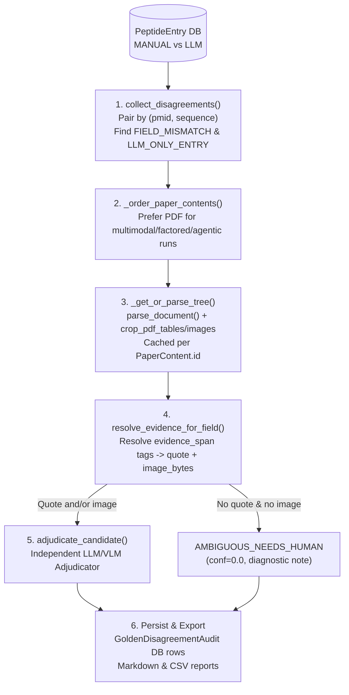

# Evidence-Grounded Golden Disagreement Auditor (`golden_auditor.py`)

This document describes the evidence-grounded disagreement auditor implemented in `src/peptide_extractor/golden_auditor.py` and persisted via `GoldenDisagreementAudit` (`src/peptide_extractor/db/golden_disagreement_audit.py`).

While `golden_benchmark.py` computes automated precision, recall, and accuracy metrics against `ExtractionMode.MANUAL` (`run_identifier=0`) entries, it cannot tell whether a mismatch is an LLM hallucination, a synonym missed by the normalizer, or an error/omission in the curated golden dataset (`SAPDB` / `PeptideMiner`). `golden_auditor.py` resolves each disagreement back to the original paper's text or cropped table/figure image and uses an independent Adjudicator LLM/VLM to classify the discrepancy.

---

## 1. End-to-End Flow (`audit_run_against_golden`)



---

## 2. Stage 1: Disagreement Collection (`collect_disagreements`)

`collect_disagreements()` queries `PeptideEntry` rows for the manual baseline (`ExtractionMode.MANUAL`, default `manual_run_identifier=0`) and the target LLM run (`ExtractionMode.LLM`, `llm_run_identifier`), optionally filtered by `pmids`.

1. **Grouping & Pairing**: Entries are grouped by `(pmid, sequence.upper())` and paired using `_match_entries_for_sequence(..., min_similarity=0.1)` from `golden_benchmark.py`.
2. **Candidate Types (`DisagreementCandidate`)**:
   - **`AuditType.FIELD_MISMATCH`**: Iterates over `DEFAULT_AUDIT_FIELDS`:
     `type`, `n_terminal`, `c_terminal`, `temperature`, `ph`, `peptide_concentration`, `solution`, `volume_ratio`, `incubation_period`, `peptide_conjugate_mixture`, `linear_cyclic`, `detection_method`.
     If both `manual_entry` and `llm_entry` have non-empty values for a field and `_values_match_normalized()` returns `False`, a `FIELD_MISMATCH` candidate is created.
   - **`AuditType.LLM_ONLY_ENTRY`**: When `include_unmatched_llm=True`, each unmatched LLM entry is emitted with `field_name="entry"` and a summary string (`seq=..., type=..., N=..., C=..., solution=..., T=..., pH=..., conc=...`).
3. **Per-PMID Caps**: To bound Adjudicator cost on large screening-table papers, collection defaults to `max_field_mismatches_per_pmid=25` and `max_unmatched_per_pmid=10` (set either to `None` to disable).

---

## 3. Stage 2: Source Document Parsing & Evidence Resolution

For each `DisagreementCandidate`, the auditor resolves `paper_id` (falling back to a `PaperMetadata` lookup by `pmid`) and loads `PaperContent` rows.

### 3.1 Format Ordering & Caching
- **`_order_paper_contents()`**: Unless `content_format` (`"pdf"` or `"xml"`) is explicitly forced, runs whose `extraction_method` is in `_PDF_PREFERRED_METHODS` (`direct_pdf`, `factored`, `multimodal_blocks`, `agentic`) try `"pdf"` content before `"xml"`.
- **`_get_or_parse_tree()`**: Lazily parses each `PaperContent` via `parse_document(raw, format=fmt, grobid_url=grobid_url, backend=pdf_backend, crop_pdf_tables=(fmt == "pdf"), crop_pdf_images=(fmt == "pdf"))` and caches `(tree, err_msg)` in `parsed_cache` keyed by `PaperContent.id`.

### 3.2 Tag Extraction & AST Lookup (`resolve_evidence_for_field`)
1. **Tag Priority (`_parse_evidence_span`)**: Parses `llm_entry.evidence_span` JSON and orders candidate tags by key priority: `field_name` → `"sequence"` → `"type"` → any remaining keys.
2. **Tag Normalization (`_extract_candidate_tags`)**: Extracts bracketed IDs (e.g., `"[sec-1/p-2/s-3]"`) or splits comma/semicolon-separated tag lists.
3. **AST Lookup with Fallbacks (`_lookup_node_with_fallback`)**:
   - **Table row tags**: Strips `/row-N` suffixes (e.g., `sec-1/table-0/row-4`), looks up the parent `TableNode`, and passes `highlight_row_idx=4`.
   - **Exact match**: Looks up `clean_id` via `get_node_by_id()`.
   - **Parent-path fallback**: Walks up path segments (e.g., `sec-1/p-2/s-9` → `sec-1/p-2`), stopping before falling back to a bare `SectionNode` heading.
4. **Evidence Rendering (`_render_node_evidence`)**:
   - **`TableNode`**: Renders caption, columns, footnotes, and either a 5-row window around `highlight_row_idx` (marked with `>>> `) or the first 15 rows, alongside any cropped `image_bytes`.
   - **Other Nodes**: Extracts `content` or `caption` (for `ParagraphNode` without direct `content`, joins child `content`), alongside any `image_bytes`.

---

## 4. Stage 3: Independent LLM/VLM Adjudication (`adjudicate_candidate`)

- **Unresolved Evidence Short-Circuit**: If neither `source_quote` nor `image_bytes` could be resolved, no LLM call is made; the candidate receives `DisagreementVerdict.AMBIGUOUS_NEEDS_HUMAN` (`confidence=0.0`) with a diagnostic `resolution_note` (missing `PaperMetadata`, missing `PaperContent`, parse failure, empty `evidence_span`, or unresolved tag).
- **Multimodal Payload (`_build_adjudicator_payload`)**: Sends plain text when only `source_quote` is present, or a multimodal `[text, image_url]` payload (base64 PNG) when `image_bytes` is attached.
- **Structured Verdicts**: Uses two `LLMController` instances (default `provider="google_genai"`, `model_name="gemini-3.5-flash-lite"`) wrapped in `retry_on_external_error`:

| Audit Type | Pydantic Schema | Allowed `DisagreementVerdict` Values |
| :--- | :--- | :--- |
| `FIELD_MISMATCH` | `FieldAdjudicationVerdict` | `llm_correct_golden_wrong`, `golden_correct_llm_wrong`, `equivalent_normalization`, `ambiguous_needs_human` |
| `LLM_ONLY_ENTRY` | `UnmatchedEntryAdjudicationVerdict` | `valid_uncurated_in_golden`, `hallucinated_or_out_of_scope`, `ambiguous_needs_human` |

Each verdict includes a `confidence` score in `[0.0, 1.0]` and a concise 1–2 sentence `reason` citing the resolved evidence.

---

## 5. Stage 4: Persistence & Reporting

1. **Database (`GoldenDisagreementAudit`)**: When `save=True`, all audit rows are persisted to the `golden_disagreement_audit` table under `audit_run_identifier` (defaults to `int(time.time())`). The schema also includes `human_verdict` and `human_notes` columns for downstream manual review.
2. **Markdown Report (`format_audit_report`)**: Generates a verdict summary table followed by per-verdict tables (`PMID`, `Seq`, `Field`, `Manual`, `LLM`, `Tag`, `Conf`, `Reason`). Optionally written to `export_markdown_path`.
3. **CSV Export (`export_audit_csv`)**: Exports all `GoldenDisagreementAudit` fields (including `source_quote`, `human_verdict`, and `human_notes`) to `export_csv_path` for spreadsheet review.

---

## 6. Usage Example

```python
from peptide_extractor.golden_auditor import audit_run_against_golden

audits, report_md = audit_run_against_golden(
    llm_run_identifier=1776152923,
    manual_run_identifier=0,
    provider="google_genai",
    model_name="gemini-3.5-flash-lite",
    grobid_url="http://localhost:8070",
    save=True,
    export_markdown_path="docs/audit_report.md",
    export_csv_path="docs/audit_report.csv",
)
```
