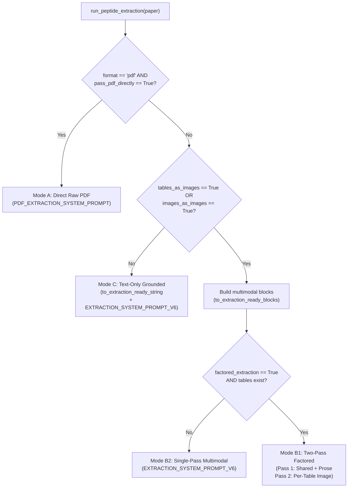

# LLM Workflows, Prompt Structures & Extraction Modes

This document details how `peptide_extractor` interacts with LLMs across its three LLM-driven stages—**Relevance Screening**, **Peptide Extraction**, and **Grounding Evaluation**—including the exact message payloads, prompt templates, decision branches, and Pydantic structured output schemas.

---

## 1. Provider & Structured Output Layer (`llm.py`)

All LLM calls go through `LLMController` (`src/peptide_extractor/llm.py`), which wraps `get_chat_model()` with `temperature=0.0` (default) and LangChain's `.with_structured_output(...)`.

### 1.1 Supported Providers

| Provider String(s) | LangChain Class | API Key Env Var(s) | Structured Output Method |
| :--- | :--- | :--- | :--- |
| `google_genai`, `google`, `google-genai` | `ChatGoogleGenerativeAI` | `GOOGLE_AI_KEY`, `GOOGLE_API_KEY`, `GEMINI_API_KEY` | `method="json_mode"` (fallback to default) |
| `ollama`, `langchain_ollama` | `ChatOllama` (`num_ctx=32000`, `num_predict=5000`) | None (`base_url` optional, e.g. `http://localhost:11435`) | `method="json_schema"` (fallback to default) |
| `open_router`, `openrouter`, `open-router` | `ChatOpenRouter` | `OPENROUTER_API_KEY`, `OPEN_ROUTER_API_KEY` | `method="json_mode"` (fallback to default) |

Streaming token output to `stdout` is supported via `StreamingTokenPrinter` (`stream=True`).

---

## 2. Stage 1: Abstract Relevance Screening (`relevance.py`)

Relevance screening triages `PaperMetadata` records (`status == not_processed`) using only their title and abstract, prioritizing **high recall** (borderline wet-lab papers are marked relevant with lower confidence; only purely computational, review, or intact full-length protein studies are discarded).

### 2.1 Single-Paper vs. Bulk Screening

| Mode | Function | LLM Method | Input Payload | Output Schema |
| :--- | :--- | :--- | :--- | :--- |
| **Single** | `screen_papers()` | `classify_paper(title, abstract)` | `HumanMessage` with `Title:` and `Abstract:` | `RelevanceResult` |
| **Bulk** (CLI default) | `bulk_screen_papers()` | `bulk_classify_paper(id_title_abstract_pairs)` | `SystemMessage(SYSTEM_PROMPT_BULK)` + `HumanMessage` containing `batch_size` papers delimited by `---` with `ID:`, `Title:`, `Abstract:` | `BulkRelevanceResults` (`results: List[PerPaperResult]`) |

### 2.2 Output Schema (`schemas.py`)

- `RelevanceResult`:
  - `detected_clues: Optional[List[str]]` — specific experimental techniques, peptide identities, or conditions.
  - `explanation: Optional[str]` — justification focusing on experimental conditions.
  - `is_relevant: Optional[bool]` — `True` -> `PaperStatus.USABLE`, `False` -> `PaperStatus.DISCARD`.
  - `confidence: Optional[float]` — score in `[0.0, 1.0]`.

Results are saved to `paper_relevance` with `provider`, `model_name`, and `run_identifier`.

---

## 3. Stage 2: Peptide Extraction (`extraction.py` & `pipeline.py`)

`run_peptide_extraction()` in `src/peptide_extractor/pipeline.py` selects one of **four distinct extraction pathways** depending on the paper's `PaperContent.format` (`"pdf"` or `"xml"`) and the pipeline flags.

### 3.1 Input Routing Decision Tree



### 3.2 Detailed Structure of What Is Passed to the LLM

#### Mode A: Direct Raw PDF (`pass_pdf_directly=True`, `format="pdf"`)
- **System Prompt**: `PDF_EXTRACTION_SYSTEM_PROMPT` (exhaustive matrix unrolling, cross-referencing shared conditions, 3-letter to 1-letter sequence conversion, terminal cap separation; no bracketed `LOCATION_GROUNDING_RULES`).
- **User Message (`HumanMessage.content`)**:
  ```python
  [
      {"type": "text", "text": "Extract all experimental peptide self-assembly information from the attached PDF document."},
      {"type": "file", "base64": "<base64-pdf>", "mime_type": "application/pdf", "filename": "paper_<id>.pdf"},
  ]
  ```
- **Output Schema**: `PeptideExtractionResult` (`entries: list[PeptideLLMEntry]`).
- **Constraint**: Raises `ValueError` if `provider` is `ollama` / `langchain_ollama`.

#### Mode B1: Two-Pass Factored Extraction (`tables_as_images=True` or `images_as_images=True`, `factored_extraction=True` [default])
Designed to prevent LLMs from truncating or dropping rows in large screening tables while avoiding redundant repetition of paper-wide defaults:

1. **Block Splitting (`_split_blocks_for_factored_extraction`)**:
   - Separates `to_extraction_ready_blocks()` output into `prose_text` (all narrative text + table/figure anchors) and `table_items: list[(table_id, caption_text, image_block)]`.
   - If `table_items` is empty, automatically falls back to single-pass `run_extraction(..., factored=False)`.

2. **Pass 1 — Paper-Wide Shared Conditions & Prose Entries**:
   - **System Prompt**: `SHARED_CONDITIONS_SYSTEM_PROMPT` (includes `LOCATION_GROUNDING_RULES`).
   - **User Message**: `HumanMessage("Fulltext:\n\n{prose_text}")`.
   - **Output Schema**: `PaperWideExtractionResult`:
     - `shared_conditions: SharedExperimentalConditions` (`n_terminal`, `c_terminal`, `temperature`, `ph`, `peptide_concentration`, `solution`, `solvent`, `volume_ratio`, `incubation_period`, `peptide_conjugate_mixture`, `conjugate_partner`, `linear_cyclic`, `chirality`, `detection_method`, `preparation_protocol`, `evidence_span`).
     - `prose_entries: list[PeptideLLMEntry]` — only entries reported in prose that are **not** covered by tables.

3. **Pass 2 — Per-Table Image Extraction (1 independent LLM call per table)**:
   - **System Prompt**: `TABLE_EXTRACTION_SYSTEM_PROMPT`.
   - **User Message (`HumanMessage.content`)**:
     ```python
     [
         {
             "type": "text",
             "text": (
                 "Paper-wide shared conditions (merged automatically; only override if this table differs):\n"
                 "<formatted shared_conditions summary>\n\n"
                 "Table location ID: [<table_id>]\n"
                 "<caption_text>\n"
                 "Extract EVERY row and EVERY tested cell from the attached table image."
             ),
         },
         {"type": "image_url", "image_url": {"url": "data:image/png;base64,..."}},
     ]
     ```
   - **Output Schema**: `TableExtractionResult`:
     - `table_defaults: Optional[SharedExperimentalConditions]`
     - `rows: list[CompactTableRow]` — each row has `sequence`, optional `n_terminal`/`c_terminal`, and `conditions: list[CompactTableCondition]` (`solution`, `solvent`, `volume_ratio`, `type`, `peptide_concentration`, `temperature`, `ph`, `incubation_period`).

4. **Deterministic Merge (`merge_table_result_with_shared`)**:
   - Unrolls each `(row, cell)` into a full `PeptideLLMEntry` using precedence:
     **`cell` -> `row` -> `table_defaults` -> `shared_conditions`**.
   - Automatically populates `EvidenceSpan` fields with `[table_id]` when sourced from the cell/row/table, or inherits the Pass 1 `shared_conditions.evidence_span` tag when sourced from paper-wide defaults.

#### Mode B2: Single-Pass Multimodal (`tables_as_images=True` or `images_as_images=True`, `factored_extraction=False`)
- **System Prompt**: `EXTRACTION_SYSTEM_PROMPT_V6` (exhaustive matrix unrolling + `LOCATION_GROUNDING_RULES`).
- **User Message**: `HumanMessage(content=blocks)` where `blocks` is the full list of text and `image_url` blocks from `to_extraction_ready_blocks(layout=table_image_layout)` (`"interleaved"` or `"appendix"`).
- **Output Schema**: `PeptideExtractionResult`.

#### Mode C: Text-Only Citation-Grounded Extraction (Default)
- **System Prompt**: `EXTRACTION_SYSTEM_PROMPT_V6` (exhaustive rules + `LOCATION_GROUNDING_RULES`).
- **User Message**: `HumanMessage(content=f"Fulltext:\n\n{extraction_ready_string}")` produced by `to_extraction_ready_string()` (either from JATS XML or GROBID TEI XML).
- **Output Schema**: `PeptideExtractionResult`.

### 3.3 `PeptideLLMEntry` & `EvidenceSpan` Schema (`db/peptide_entry.py`)

Each extracted `PeptideLLMEntry` contains:
- **Sequence & Structure**: `sequence` (uppercase 1-letter IUPAC), `n_terminal`, `c_terminal`, `linear_cyclic` (`linear` | `cyclic`), `chirality` (`L`, `D`, `heterochiral`, `racemic`, `achiral`), `peptide_conjugate_mixture` (`peptide` | `conjugate` | `mixture`), `conjugate_partner`.
- **Outcome**: `type` (`PeptideAssemblyType`: `none`, `ribbon`, `nanosphere`, `organogel`, `tube`, `particle`, `vesicle`, `hydrogel`, `fiber`, `amyloid`).
- **Experimental Conditions**: `temperature` (°C float, RT -> `25.0`), `ph` (float), `peptide_concentration` (mg/ml float, `1 wt%` -> `10.0`), `solution`, `solvent`, `volume_ratio` (`list[int]`, e.g. `[50, 50]` or `[1]`), `incubation_period` (minutes int).
- **Methodology**: `detection_method` (`list[str]`), `preparation_protocol` (verbatim string).
- **Grounding (`EvidenceSpan`)**: Maps 12 properties (`sequence`, `type`, `n_terminal`, `c_terminal`, `temperature`, `ph`, `peptide_concentration`, `solution`, `solvent`, `incubation_period`, `conjugate_partner`, `chirality`) to a single bracketed location tag (e.g., `"[sec-1/p-2/s-1]"` or `"[sec-1/table-0]"`).

`peptide_llm_entry_to_peptide_entry()` normalizes casing, computes `length`, formats `volume_ratio` (`"50/50"` or `"1"`), joins `detection_method` with commas, serializes `evidence_span` to JSON, and sets `extraction_mode=ExtractionMode.LLM`.

---

## 4. Stage 3: Evaluation & Benchmarking

### 4.1 Reference-Free Grounding & Completeness (`evaluation.py`)

`evaluate_extraction(extraction, fulltext, model=None)` computes two metrics per `PeptideEntry` without requiring ground truth:

1. **`completeness_rate`**: Fraction of non-null fields out of **16** (if `peptide_conjugate_mixture == "peptide"`) or **17** (if `conjugate` / `mixture`, where `conjugate_partner` is expected).
2. **`groundness_rate`**: Fraction of checkable non-null fields that are verified against `fulltext`:
   - **Location-grounded fields (`EVIDENCE_SPAN_FIELDS` + optional `conjugate_partner`)**:
     1. Parses `fulltext` into a sentence-segmented `Node` tree (`parse_xml` -> `add_sentences`).
     2. Looks up each field's `evidence_span` location tag via `get_node_by_id()`.
     3. Sends `[(field, value, quote_text), ...]` to `groundness_check_llm()` (`GROUNDNESS_CHECK_SYSTEM_PROMPT` -> `GroundnessVerdict(field_verdict: dict)`, defaulting to `ollama` `deepseek-r1:8b` at `http://localhost:11435`).
   - **Verbatim fields (`preparation_protocol`)**: Verified directly via exact substring match or `rapidfuzz.fuzz.partial_ratio >= 90.0`.
   - **Detection methods (`detection_method`)**: Split by `,`; grounded if `>= 80%` of listed methods match in `fulltext` (exact or fuzzy `>= 90.0`).

### 4.2 Golden Dataset Benchmarking (`golden_benchmark.py`)

`benchmark_run_against_golden(llm_run_identifier, ...)` compares an LLM run against `ExtractionMode.MANUAL` (`run_identifier=0`) entries across the golden dataset (including the 10-paper `DEV_BENCHMARK_PMIDS` slice):

1. **Normalization**: Canonicalizes `n_terminal` (`Ac` -> `acetylation`), `c_terminal` (`NH2` -> `amidation`), `volume_ratio` (`5/95` vs `5:95`), solvent tokens (`HFIP`/`HFP` -> `hfp`, `phosphate-buffered saline` -> `pbs`), detection method tokens (`TEM`, `Cryo-EM`, `ThT`, etc.), and numeric tolerances (`temperature` ±1.5 °C, `ph` ±0.2, `peptide_concentration` ±10% relative, `incubation_period` ±10%).
2. **Entry Matching**: Groups manual and LLM entries by `(pmid, sequence)` and performs greedy bipartite matching using `condition_similarity(manual, llm)` across shared fields.
3. **Reporting (`GoldenBenchmarkReport`)**: Outputs paper coverage, entry-level **Precision / Recall / F1**, and per-field match accuracy (`FieldMatchStats`).
