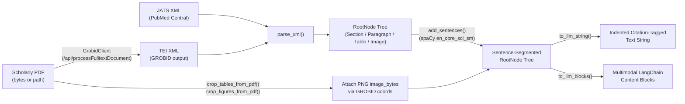

# Document Parsing, Node Tree & Multimodal Input Construction

`src/peptide_extractor/parsers.py` and `src/peptide_extractor/table_renderer.py` convert heterogeneous scientific publications (**JATS XML**, **TEI XML**, and **scholarly PDFs**) into a single, citation-grounded hierarchical representation. This ensures that downstream LLM prompts and grounding evaluators operate identically regardless of source format.

---

## 1. Supported Input Formats & Conversion Flow



### Format Auto-Detection (`parse_document`)

`parse_document(content, format="auto", ...)` resolves the input format automatically:
1. **`is_pdf(content)`**: Returns `True` if `bytes` start with `b"%PDF"`, `Path` ends with `.pdf`, or `str` points to an existing `.pdf` file.
   - Calls `pdf_to_tei_xml()`, which connects to a running **GROBID** REST service (`GROBID_URL`, default `http://localhost:8070`, `backend="grobid"`, with configurable `max_retry` and `retry_timeout`).
   - When `crop_pdf_tables=True` or `crop_pdf_images=True`, passes `tei_coordinates=["figure"]` to GROBID so every table and figure element includes PDF page bounding-box coordinates (`coords`).
2. **`is_tei_xml(raw_text)`**: Checks for `<TEI`, `<teiHeader`, or `http://www.tei-c.org/ns/1.0`.
3. **Fallback (`"xml"`)**: Treated as JATS XML.

> [!NOTE]
> For Docker and standalone GROBID server setup instructions, see [docs/project_notes/grobid_setup.md](project_notes/grobid_setup.md).

---

## 2. The Unified `Node` Object Tree

`parse_xml()` locates the `<body>` (or `<text>` fallback) element using `BeautifulSoup(..., "xml")` and recursively constructs a tree of `Node` objects. Reference lists (`<ref-list>`), acknowledgments, and non-body boilerplate are naturally excluded because traversal only descends into `<sec>`/`<div>`, `<p>`, tables, and figures.

### 2.1 Node Classes & Location IDs

Every node receives a deterministic hierarchical ID via `construct_node_id(parent_id, current_id)`:

| Node Class | XML Tags Matched | ID Segment | Key Attributes |
| :--- | :--- | :--- | :--- |
| `RootNode` | `<body>` / `<text>` | `""` | `children` |
| `SectionNode` | `<sec>`, `<div>` | `sec-{i}` | `content` (from `<title>` or `<head>`) |
| `ParagraphNode` | `<p>` | `p-{j}` | `content` (nested tables stripped so text isn't duplicated) |
| `SentenceNode` | *(generated)* | `s-{k}` | `content` (segmented from `ParagraphNode.content` by `add_sentences()`) |
| `TableNode` | `<table-wrap>`, `<table>`, `<figure type="table">` | `table-{m}` | `caption`, `columns`, `rows`, `footnotes`, `grid` (colspan/rowspan/is_header), `coords`, `image_bytes` |
| `ImageNode` | `<fig>`, `<figure>` (non-table) | `fig-{n}` | `caption` (from `<caption>`, `<head>`, `<figDesc>`), `coords`, `image_bytes` |

Example resulting ID paths:
- `[sec-0]` — First top-level section
- `[sec-0/p-1/s-2]` — Third sentence of the second paragraph in the first section
- `[sec-2/sec-0/table-0]` — First table inside a nested subsection
- `[sec-2/sec-0/table-0/row-3]` — Fourth data row of that table
- `[sec-1/fig-0]` — First figure in the second section

### 2.2 Sentence Segmentation (`add_sentences`)

`add_sentences(root)` loads the scientific spaCy model `en_core_sci_sm` (with static vectors disabled for speed) and splits every `ParagraphNode.content` into `SentenceNode` children (`s-0`, `s-1`, ...).

### 2.3 Node Lookup (`get_node_by_id`)

`get_node_by_id(paper_tree, id)` strips square brackets (`[` / `]`) and traverses the tree to return the exact `Node` object matching a citation tag. This is used during grounding evaluation (`evaluation.py`) to resolve LLM-cited `evidence_span` tags back to the exact sentence, table, or figure.

---

## 3. PDF Table & Figure Cropping (`table_renderer.py`)

When parsing PDFs with `tables_as_images=True` or `images_as_images=True`, `parse_document()` invokes `crop_tables_from_pdf()` and/or `crop_figures_from_pdf()` using **PyMuPDF (`fitz`)** and **Pillow**:

1. **Coordinate Parsing (`parse_grobid_coords`)**: Parses semicolon-separated GROBID `coords` strings (`page,x,y,w,h;...`) into `(page_num, x, y, w, h)` bounding boxes.
2. **Table Cropping (`crop_tables_from_pdf`)**:
   - Uses full page width (`page_rect.x0` to `page_rect.x1`) from `table_y0 - padding` down to the next table's top (`next_tops[0] - 4.0`) or page bottom, ensuring multi-column or wide tables and footnotes are not clipped.
   - Renders at `dpi=200` with `padding=8.0`.
   - Multi-page tables are vertically stitched into a single PNG via `_stitch_page_images()`.
   - Stores PNG bytes in `table_node.image_bytes`.
3. **Figure Cropping (`crop_figures_from_pdf`)**:
   - Uses tight bounding boxes around the figure's GROBID `coords` with `padding=8.0` at `dpi=200`, stitching multi-page regions if needed, and stores PNG bytes in `image_node.image_bytes`.

---

## 4. Serialization Formats for LLMs

### 4.1 Text-Only String (`to_llm_string`)

`to_llm_string(paper_tree)` (and convenience wrappers `to_extraction_ready_string`, `extraction_ready_string_from_xml`, `extraction_ready_string_from_pdf`) renders the tree into an indented, bracket-tagged string:

```text
[sec-0] Introduction
	[sec-0/p-0]
		[sec-0/p-0/s-0] Diphenylalanine motifs self-assemble into nanotubes in water.
[sec-1] Results
	[sec-1/table-0] Table 1. Assembly behavior across solvents
		Columns: Peptide | Solvent | Concentration (mg/ml) | Morphology
		[sec-1/table-0/row-0] FF | H2O | 2.0 | nanotube
		[sec-1/table-0/row-1] Fmoc-FF | DMSO/H2O | 5.0 | hydrogel
```

### 4.2 Multimodal Content Blocks (`to_llm_blocks`)

`to_llm_blocks(paper_tree, layout="interleaved", tables_as_images=True, images_as_images=True)` produces a `list[dict[str, Any]]` compatible with LangChain multimodal `HumanMessage(content=blocks)`:

- **When `tables_as_images=False` and `images_as_images=False`**: Returns a single text block `[{"type": "text", "text": to_llm_string(paper_tree)}]`.
- **When `image_bytes` is present on a `TableNode` or `ImageNode`**:
  - **`layout="interleaved"`** (default): Flushes accumulated text, emits an anchor line (`>>> [TABLE IMAGE ATTACHED: sec-1/table-0] <<<` or `>>> [FIGURE IMAGE ATTACHED: sec-1/fig-0] <<<`), and immediately appends `{"type": "image_url", "image_url": {"url": "data:image/png;base64,..."}}`.
  - **`layout="appendix"`**: Keeps a reference anchor in the prose (`>>> [SEE APPENDIX TABLE IMAGE: sec-1/table-0] <<<`) and appends all visual blocks at the end under `=== APPENDIX TABLE IMAGE: [sec-1/table-0] ===` headers with caption and footnotes.
- **Fallback for XML / uncropped tables**: If `node.image_bytes is None` (e.g., JATS XML without PDF), `to_llm_blocks` automatically falls back to rendering the structured pipe-separated text table (`Columns: ...` and `[id/row-i] ...`) inline.
