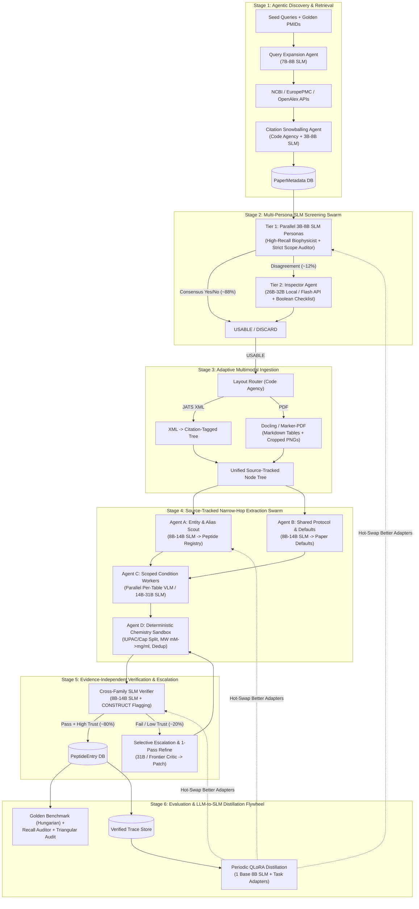

# SLM-First End-to-End Agentic Architecture for Scientific Literature Mining
**A Deep-Dive Research Report on Small-Model Multi-Agent Pipelines for `peptide_extractor`**

---

## 1. Core Thesis: Why Small Language Models (SLMs) Fit Agentic Scientific Pipelines

Recent 2025–2026 research marks a sharp shift away from monolithic frontier-LLM pipelines toward **heterogeneous, SLM-first agentic workflows**—systems where small, fast, locally hostable models (3B–32B parameters, runnable via Ollama/vLLM) execute narrow, structured sub-tasks, while larger models are invoked sparingly as teachers, escalators, or offline optimizers.

### 1.1 The Theoretical & Empirical Case from 2025–2026 Literature

| Study | Core Concept | Key Empirical Takeaway for `peptide_extractor` |
| :--- | :--- | :--- |
| **Small Language Models are the Future of Agentic AI** *(Belcak et al., NVIDIA Research, [arXiv:2506.02153v3](https://arxiv.org/html/2506.02153v3), Sept 2026)* | **Code Agency vs. LM Agency**; **Heterogeneous SLM-First Systems**; **6-Step LLM-to-SLM Conversion Algorithm (S1–S6)**. | Agentic subtasks are narrow, repetitive, and strictly formatted—a 7B–9B SLM is **10–30× cheaper/faster** than a 70B–175B LLM and easily LoRA-specialized. Specialized 7B–8B models (e.g., `xLAM-2-8B`, `DeepSeek-R1-Distill-Qwen-7B`) match or exceed frontier models on bounded tool-calling and extraction. |
| **Source-Tracked Multi-Stage Extraction** *(Wang et al., [arXiv:2510.05142v1](https://arxiv.org/html/2510.05142v1), Oct 2025)* | Decomposing a 47-feature materials schema into **4 narrow, sequential stages** (Composition/Processing → Microstructure → Properties → Validation) with **mandatory source tracking**. | Eliminating single-pass cognitive overload cut missed materials from **12.4% → 3.3%** with **zero false positives** and lifted tuple-level F1 from **0.880 → 0.962** (using a small reasoning model, `o3-mini`). *Critical insight*: multi-stage *without* source tracking actually hurt recall; source anchoring was the decisive factor. |
| **SciKGExtract** *(Sadruddin & D'Souza, [arXiv:2610.06322v1](https://arxiv.org/html/2610.06322v1), Oct 2026)* | Schema-guided extraction + chemical canonicalization + selective judge reflection across model sizes (`Ministral 3B`, `Gemma 4 26B`, `Llama 3.3 70B`, `GPT-4o`). | **Ministral 3B** jumped from 0.473 → **0.673 F1** on ZnO and reached **0.334 F1** on complex IGZO—**outperforming GPT-4o (0.268)**! **Gemma 4 26B** reached **0.719 F1** at ~$0.0006/request (~28× cheaper than GPT-4o). |
| **Neuro-Symbolic SLM Agents & Failure Modes** *([arXiv:2607.14149v1](https://arxiv.org/html/2607.14149v1), Jul 2026)* | Stress-testing 1B–4B SLMs (`Gemma 3 1B/4B`, `Llama 3.2 3B`) in multi-hop tool-using extraction pipelines. | Identifies three exact failure modes of SLMs: **(1) Lost-in-the-middle**, **(2) Quantization trap** (noise compounds across 4+ sequential hops), and **(3) Distraction effect** (noisy self-extracted facts corrupt downstream steps). *Fix*: keep each SLM node to **1–2 hops** with **deterministic validation between hops**. |
| **ScrapeGraphAI-100k** *(Nov 2026, HuggingFace)* & **Distil Labs** *(Oct 2025)* | Task-specific distillation of structured JSON extraction from frontier teacher logs into 1.7B–8B SLMs. | A fine-tuned **1.7B SLM** dramatically closed the gap to a 30B baseline on structured Markdown → JSON extraction; SLMs shine when facts come from provided documents rather than parametric memory. |
| **AgentSLR** *(ICML 2026)*, **Two-MAS SLR** *([arXiv:2607.21920v1](https://arxiv.org/html/2607.21920v1), Jul 2026)*, & **Patience is All You Need** *([arXiv:2504.08752v1](https://arxiv.org/html/2504.08752v1))* | Full-pipeline multi-agent systematic literature reviews: **Search/Query Agent → Citation Expansion → Multi-Persona Screening Swarm → Iterative Extraction → Verification**. | End-to-end agentic pipelines achieved a **58× speedup** with human-comparable recall; heterogeneous persona swarms on small/cheap models corrected single-model conservatism (sensitivity **58.3% → 92.6%**) while surfacing ambiguous cases for HITL. |

> [!IMPORTANT]
> **The Golden Architectural Rule for SLM Agents — "Code Agency" Over "LM Agency":**
> In NVIDIA's taxonomy ([arXiv:2506.02153v3](https://arxiv.org/html/2506.02153v3), Fig. 1), **LM Agency** lets one LLM autonomously plan open-ended loops (where SLMs collapse due to sequential fragility). **Code Agency** uses a deterministic Python state machine (e.g., **LangGraph** or an explicit typed workflow graph) to orchestrate narrow, grammar-constrained SLM worker nodes and deterministic tools. For `peptide_extractor`, **Code Agency + narrow SLM workers** is far more reliable, debuggable, and cheaper than free-form ReAct loops.

---

## 2. End-to-End SLM-First Agentic Blueprint (All 6 Pipeline Stages)

Below is a full-pipeline agentic architecture covering **Discovery/Retrieval → Screening → Multimodal Parsing → Source-Tracked Extraction → Verification & Escalation → Evaluation & Distillation**, specifically engineered to run predominantly on small open-weight models (`3B–31B`) with selective escalation.

---

### Stage 1: Agentic Literature Retrieval & Discovery ([providers.py](../../src/peptide_extractor/providers.py))

Currently, retrieval relies on static hand-written Boolean queries ([paper-retrieval notes.md](../personal_notes/paper-retrieval%20notes.md)). An agentic retrieval layer increases recall on older or non-standard peptide papers without blowing up noise:

1. **Query-Reformulation & Synonym Agent (`7B–8B SLM`)**:
   - Inspects false-negative golden papers (or newly discovered high-value `USABLE` papers) and extracts missing domain phrasing (e.g., *"low-molecular-weight peptide gelator"*, *"amphiphilic oligopeptide"*, *"short aromatic dipeptide/tetrapeptide"*, *"cross-β fibrillization"*).
   - Emits candidate PubMed/Europe PMC query clauses validated deterministically against hit-count bounds before execution.
2. **Citation Snowballing Agent (`Code Agency + 3B–8B SLM`)**:
   - Inspired by *Patience is All You Need* ([arXiv:2504.08752v1](https://arxiv.org/html/2504.08752v1)) and *AgentSLR*, uses Europe PMC / OpenAlex / NCBI ELink APIs to traverse **backward references** and **forward citations** of confirmed `USABLE` papers (and SAPDB/PeptideMiner seed papers).
   - A lightweight `3B–8B` SLM pre-ranks candidate titles/abstracts before ingesting them into `PaperMetadata`, recovering experimental papers that never used the phrase `"self-assembly"` in their title.

---

### Stage 2: Multi-Persona SLM Screening Swarm ([relevance.py](../../src/peptide_extractor/relevance.py))

Instead of 10-paper bulk calls to a single model, deploy a **2-tier SLM screening swarm** (directly adapting [arXiv:2607.21920v1](https://arxiv.org/html/2607.21920v1) and [medRxiv 25333429v4](https://www.medrxiv.org/content/10.1101/2025.08.11.25333429v4)):

- **Tier 1 — Heterogeneous Local SLM Trio (`3B–8B`, Grammar-Constrained JSON)**:
  - Run **2 or 3 distinct small models or personas** concurrently on each single abstract (zero cross-paper bleed):
    1. **High-Recall Biophysicist** (`qwen3:8b` or `gemma-4` small): Votes `YES` if any wet-lab peptide assembly/aggregation evidence is plausible.
    2. **Strict Scope Regulator** (`llama3.2:3b` or `ministral:8b`): Explicitly checks exclusion criteria (review/perspective? MD/DFT simulation only? full-length protein >30aa without isolated fragment?).
    3. *(Optional)* **Criteria Checker** (Boolean decomposition): Outputs 4 atomic booleans (`short_peptide`, `wet_lab_experiment`, `assembly_outcome`, `not_review`) rather than a single opaque label.
  - **Consensus Rule**: Unanimous `YES` → `USABLE`; unanimous `NO` → `DISCARD`.
- **Tier 2 — Disagreement Inspector (`26B–31B` Local or `gemini-flash`)**:
  - Invoked **only on the ~10–15% non-consensus abstracts**, receiving both Tier-1 rationales and the atomic booleans.
  - **Result**: Achieves >95% recall while keeping ~85–90% of screening completely free on local `3B–8B` models.

---

### Stage 3: Adaptive Multimodal Ingestion Agent ([parsers.py](../../src/peptide_extractor/parsers.py) & [table_renderer.py](../../src/peptide_extractor/table_renderer.py))

Small models suffer severely from noisy OCR and broken XML tables. Making ingestion **agentic and layout-adaptive** removes the #1 error source before extraction even starts:

- **Layout Router (`Code Agency`)**:
  - Checks whether a paper is JATS XML or PDF, counts tables/figures, and inspects table density.
  - Routes PDFs through **`Docling`** (used by SciKGExtract) or **`marker-pdf`** (used by MDA/ChemX) to obtain clean Markdown tables + cropped table/figure PNGs, then injects your deterministic bracketed citation IDs (`[sec-1/p-2/s-1]`, `[sec-1/table-0]`).
- **Visual-Only Scheme/Table Pre-Transcriber (`7B–12B VLM`, e.g., `Qwen2.5-VL-7B` or `Gemma-4` VLM)**:
  - Only triggered when a table or chemical scheme (e.g., *Scheme 1: Peptide structures & terminal caps*) is purely graphical or poorly parsed. Emits structured Markdown + `[fig-X]`/`[table-X]` tags so downstream text SLMs never have to process raw full-PDF images.

---

### Stage 4: Source-Tracked, Narrow-Hop SLM Extraction Swarm ([extraction.py](../../src/peptide_extractor/extraction.py))

Why do small models fail on single-pass extraction? Because extracting 17 fields across 50 table rows simultaneously triggers **cognitive overload** and **lost-in-the-middle** degradation ([arXiv:2510.05142v1](https://arxiv.org/html/2510.05142v1), [arXiv:2607.14149v1](https://arxiv.org/html/2607.14149v1)).

The solution is **horizontal + vertical task decomposition** orchestrated by a deterministic state graph (**LangGraph** or lightweight Python state machine), where **every SLM node has a tiny schema, a short context, grammar-constrained JSON decoding, and mandatory `[loc]` source tracking**:

| Agent Node | Model Tier | Scoped Input | Narrow Single-Hop Output |
| :--- | :--- | :--- | :--- |
| **Node A: Entity & Alias Scout** | `8B–14B SLM` | Intro + Methods + Table/Scheme captions (trimmed context) | `PeptideRegistry`: maps every alias (`"1a"`, `"P3"`, `"cyclo(KL)"`) → `(sequence, n_terminal, c_terminal, linear_cyclic, chirality, peptide_conjugate_mixture, conjugate_partner, [loc])`. |
| **Node B: Shared Defaults Extractor** | `8B–14B SLM` | Methods + Experimental Section only | `SharedExperimentalConditions`: paper-wide `temperature`, `ph`, `incubation_period`, `solution`, `solvent`, `volume_ratio`, `detection_method`, `preparation_protocol`, each with `[loc]`. |
| **Node C1: Per-Table Condition Worker** *(parallel)* | `7B–12B VLM` or `26B–31B SLM` | Compact `PeptideRegistry` + `SharedDefaults` + **1 single table** (Markdown + PNG) | `TableExtractionResult`: compact `(alias/sequence, conditions[])` rows for that table only. |
| **Node C2: Prose-Only Condition Worker** | `8B–14B SLM` | Results paragraphs (excluding table-covered text) + `PeptideRegistry` | `prose_entries`: only experimental rows not already in tables. |
| **Node D: Deterministic Chemistry & Schema Sandbox** | **Zero-LLM (Python)** | Merged outputs of A + B + C1 + C2 | 1. Resolves aliases via `PeptideRegistry`. 2. Strips leaked caps (`Ac-`, `Fmoc-`, `-NH2`, `cyclo()`) into `n_terminal`/`c_terminal`/`linear_cyclic`. 3. Computes exact `mg/ml` from `(raw_conc, mM/µM/wt%)` + peptide MW. 4. Canonicalizes solvents & detection methods. 5. Deduplicates prose vs. table overlaps. 6. Emits a structured `ValidationReport` (errors & warnings). |

**Why this works with SLMs**: No small model ever has to hold the entire paper, invent MW math, or remember 17 schema rules across 200 rows at once. Every hop is validated deterministically before the next hop consumes it—directly preventing the **distraction effect** and **sequential fragility** documented in [arXiv:2607.14149v1](https://arxiv.org/html/2607.14149v1).

---

### Stage 5: Evidence-Independent Verification & Selective Escalation ([extraction.py](../../src/peptide_extractor/extraction.py) + [evaluation.py](../../src/peptide_extractor/evaluation.py))

Following **SciKGExtract** (*"more agents are not always better"*), **CONSTRUCT** ([arXiv:2603.18014v2](https://arxiv.org/html/2603.18014v2)), and the **Evidence Independence** principle:

1. **Fast Cross-Family SLM Verifier (`8B–14B`, different model family from Extractor)**:
   - Receives **only** `(extracted_entry, resolved_source_snippets_or_table_markdown)`—never the extractor's reasoning trace.
   - Runs **CONSTRUCT-style 2-step verification**:
     - *Step 1*: Flag any field that is unsupported, misattributed to another peptide, or missing a terminal cap/solvent.
     - *Step 2*: Emit a binary/calibrated trust tier (`HIGH` / `MEDIUM` / `LOW`).
2. **Row-Count & Sequence Recall Guard (`Code Agency + 8B SLM`)**:
   - Compares `len(table_result.rows)` against the Markdown table row count and checks whether every sequence in `PeptideRegistry` appeared in at least one extracted entry.
3. **Confidence-Gated Escalation (Heterogeneous Routing)**:
   - **~75–85% of papers** pass Deterministic Sandbox + SLM Verifier → saved directly to DB at near-zero cost.
   - **~15–25% of papers** (flagged with validation errors, row-count mismatch, or `LOW` trust) escalate to a **stronger Critic/Refiner** (`gemma-4-31b-it` or frontier API) for **at most 1–2 targeted patch iterations** (`Reflect → Feedback → Refine`).

---

### Stage 6: Evaluation & the Continuous LLM-to-SLM Distillation Flywheel

This is NVIDIA's highest-leverage insight ([arXiv:2506.02153v3](https://arxiv.org/html/2506.02153v3), Section 6 — **Steps S1–S6**) applied directly to `peptide_extractor`:

1. **S1 — Trace Logging**: Decorate `LLMController` to log every `(agent_role, prompt, input_context, structured_json_output, validation_passed, trust_score)` into a local trace table/Parquet store.
2. **S2 — Automated Quality Filtering**: Keep only traces that pass **(a)** all Phase-3 deterministic chemistry checks, **(b)** high CONSTRUCT grounding score, and/or **(c)** golden-dataset Hungarian match or expert audit.
3. **S3 — Task Clustering**: The pipeline naturally decomposes into 4–5 clean, repeatable tasks (`screener`, `entity_scout`, `defaults_extractor`, `table_worker`, `grounding_verifier`).
4. **S4 & S5 — Multi-LoRA SLM Specialization**:
   - Instead of hosting 5 separate models, take **one strong 7B–9B open-weight base model** (e.g., `Qwen3-8B` or `Llama-3.1-8B-Instruct`) and train lightweight **QLoRA adapters** (each ~50–100 MB, trainable in a few GPU-hours on a single consumer GPU) distilled from your strongest teacher runs (e.g., `gemma-4-31b-it` / `gemini` + CAPO-optimized prompts + golden dataset).
   - Serve all 5 specialist agents from **one base model** via vLLM/Ollama multi-LoRA adapter swapping.
5. **S6 — Closed-Loop Retraining**: As new papers are extracted and escalated cases are corrected by the stronger model or human auditors, feed those hard edge cases back into the next QLoRA distillation cycle—progressively shrinking the escalation rate from ~20% down to <5%.

---

## 3. Concrete Model & Hardware Allocation Matrix

A practical mapping of open-weight models (runnable locally on 1× 24 GB–48 GB GPU via Ollama/vLLM) to each agent node:

| Agent Role | Recommended Local SLM | Context Size Needed | Structured Decoding | Escalation Trigger & Target |
| :--- | :--- | :--- | :--- | :--- |
| **Query & Snowball Agent** | `qwen3:8b` or `llama3.2:3b` | 2K–4K | JSON Schema | None needed |
| **Screening Swarm (Tier 1)** | `llama3.2:3b` + `qwen3:8b` (or `ministral:8b`) | 1K–2K (single abstract) | JSON Schema | Disagreement (~12%) → `gemma-4-31b-it` / `gemini-flash` |
| **Visual Table/Scheme Reader** | `Qwen2.5-VL-7B` or `gemma-4` multimodal | 4K–8K + 1 image | JSON Schema | Low-res / complex multi-page table → Frontier VLM |
| **Entity Scout (Node A)** | `qwen3:8b` or `qwen3:14b` (or LoRA-tuned 8B) | 8K–16K | JSON Schema | Invalid IUPAC / unresolved aliases → `gemma-4-31b-it` |
| **Shared Defaults (Node B)** | `qwen3:8b` or `phi-4` (14B) | 6K–12K | JSON Schema | Missing `detection_method` / `temperature` → `gemma-4-31b-it` |
| **Per-Table Worker (Node C)** | `gemma-4-26b/31b` or `qwen3:14b` (on Markdown+PNG) | 4K–8K | JSON Schema | Row-count mismatch → 1-pass Refine with `gemma-4-31b-it` / Frontier |
| **Grounding Verifier (Stage 5)** | `deepseek-r1:8b` or `qwen3:8b` *(different family from extractor)* | 2K–4K (snippets only) | CONSTRUCT JSON | `LOW` trust → Escalate to 1-pass Critic/Refine |
| **Offline CAPO Analyst/Refiner** | Frontier API (`gemini-pro` / `claude` / `gpt-5`) | 16K–32K | Structured JSON | Runs offline once on 10 dev papers; zero runtime cost |

---

## 4. SLM-Specific Engineering Pitfalls & Mitigations

1. **Grammar-Constrained Decoding is Mandatory**:
   - SLMs (<14B) frequently break JSON syntax or invent extra enum values under free generation. Always enforce `json_schema` / CFG constrained decoding (Ollama `format=<json_schema>`, vLLM `guided_json` / `xgrammar`) rather than prompt-only JSON formatting.
2. **Avoid Quantization Traps on Multi-Hop Chains**:
   - Use **Q4_K_M / Q8_0** (never Q2/Q3) for extraction SLMs, and never chain >2 unvalidated SLM calls sequentially—insert deterministic Python checks (Node D) between every stage.
3. **Keep Context Tight (<8K–12K tokens per SLM call)**:
   - Even if an 8B model advertises a 32K–128K context window, its effective attention degrades sharply past ~12K tokens (*lost-in-the-middle*). Section-routing (Methods only → Node B; 1 table only → Node C) keeps every SLM inside its high-accuracy sweet spot.
4. **Do Not Use "Thinking" Mode Blindly on Small Models for Bulk JSON**:
   - Reasoning traces (`deepseek-r1:8b`) are great for the **Verifier / Inspector** role, where step-by-step auditing helps catch misattributions, but often waste output tokens and hurt schema adherence on bulk table-row extraction.

---

## 5. Phased Adoption Path (From Current Codebase to SLM-First Agentic Swarm)

1. **Phase 1 — Refactor `extraction.py` into a Code-Agency State Graph (LangGraph / Typed DAG)**:
   - Split current Pass 1 into **Node A (Entity Registry)** + **Node B (Shared Defaults)**, keep **Node C (Parallel Per-Table Workers)**, and add **Node D (Deterministic Chemistry Sandbox)**.
   - Immediately test with existing `gemma-4-31b-it` + local `8B` models on `DEV_BENCHMARK_PMIDS`.
2. **Phase 2 — Add Stage 2 SLM Screening Swarm + Stage 5 Cross-Family Verifier & Escalation Router**:
   - Replace bulk-10 screening with parallel 2-persona `3B–8B` SLMs + Tier-2 Inspector on disagreements.
   - Wire `evaluation.py` into a **closed-loop gate** that triggers 1-pass refinement only on flagged papers.
3. **Phase 3 — Add Stage 1 Agentic Retrieval (Query Expansion + Citation Snowballing)**:
   - Extend `providers.py` with an automated snowballing & synonym-discovery loop seeded by the golden dataset.
4. **Phase 4 — Turn on Trace Logging & QLoRA Distillation (NVIDIA S1–S6)**:
   - Once 500–2,000 high-trust verified extractions are accumulated across the corpus, distill `screener`, `entity_scout`, and `verifier` into LoRA adapters on a single `8B` base model for fast, private, near-zero-cost large-scale curation.
